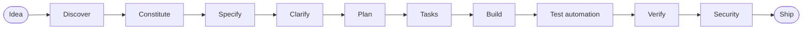

# SpecPilot

**Spec-Driven Development for the AI software lifecycle.** Install it in any repository. It profiles the codebase, then keeps your AI agent inside a gated process: no code without an approved spec, every requirement traced to a task and a test, and security checked before ship.



A human approves at every arrow. The `sdd` CLI checks what can be checked mechanically.

## Install

One command, for Claude Code, Cursor, Codex, Copilot, Gemini CLI and other agents that support skills:

```bash
npx skills add ashishmohanty-99/spec-driven-development
```

Then ask your agent: **"Set up SpecPilot in this repository."** The skill carries its own command-line tool (Python 3.11+, standard library only) and copies it into your project, so teammates and CI need nothing installed.

Other ways to get the same thing:

| Route | Command |
|---|---|
| Claude Code plugin | `/plugin install specpilot --marketplace ashishmohanty-99/spec-driven-development` |
| Python package | `pipx install git+https://github.com/ashishmohanty-99/spec-driven-development`, then `sdd init` |
| claude.ai upload | `python tools/build_skill.py`, then upload `dist/specpilot-skill.zip` at Customize → Skills |
| By hand | Copy the `skills/specpilot` folder into `~/.claude/skills/` (or your agent's skills folder) |

## Use

```text
/sdd-init                       learn the codebase
/sdd-constitution               rules for every change        (you ratify)
/sdd-spec "idea"                testable requirements         (you approve)
/sdd-clarify <feature>          close open questions
/sdd-plan <feature>             design mapped to real files   (you approve)
/sdd-tasks <feature>            small traceable tasks         (you approve)
/sdd-build <feature>            one task, test first
/sdd-gen-tests <feature>        browser tests from the spec
/sdd-verify <feature>           evidence per requirement
/sdd-ship <feature>             readiness report              (you merge)
```

```bash
sdd status                                # where every feature is
sdd verify --strict                       # traceability and approval gates
sdd regression --strict                   # unit + e2e + gates, one exit code
sdd pentest --target . --authorized       # guarded Strix scan
```

## Documentation

The [wiki](https://github.com/ashishmohanty-99/spec-driven-development/wiki) is the manual (source in [`wiki/`](wiki/) and [`skills/specpilot/references/`](skills/specpilot/references/)):

| Page | For |
|---|---|
| [Getting Started](wiki/Getting-Started.md) | Install and first feature |
| [SDD and the AI SDLC](skills/specpilot/references/SDD-and-the-AI-SDLC.md) | Why the process exists |
| [Step-by-Step Workflow](skills/specpilot/references/Step-by-Step-Workflow.md) | Every phase: who acts, what to check |
| [Test Automation](skills/specpilot/references/Test-Automation.md) | Spec → pytest-playwright tests |
| [Penetration Testing](skills/specpilot/references/Penetration-Testing.md) | Strix without exposing an API key |
| [Security Model](skills/specpilot/references/Security-Model.md) | Threats, controls, tests |
| [CLI Reference](skills/specpilot/references/CLI-Reference.md) · [Extending](skills/specpilot/references/Extending.md) · [Troubleshooting](skills/specpilot/references/Troubleshooting.md) | Reference |

## Security in one paragraph

No command, config field or prompt accepts an API key. The pentest step lets Strix read `LLM_API_KEY` from your own environment, or runs keyless against a local model. Child processes get a minimal environment, never a shell. Paths are confined to the project root and never written through symlinks. Spec text cannot become code. `sdd audit` and `sdd verify` fail on committed credentials. A scan that did not run exits 3, never 0. Details and the test for each control: [Security Model](skills/specpilot/references/Security-Model.md). Report vulnerabilities privately: [SECURITY.md](SECURITY.md).

## Repository layout

| Path | Contents |
|---|---|
| `skills/specpilot/` | **The skill.** `SKILL.md`, the bundled CLI under `scripts/`, reference pages under `references/` |
| `skills/specpilot/scripts/specpilot/` | CLI source: `scan`, `spec` (gates), `gentests`, `regression`, `pentest`, `audit`, `security` |
| `skills/specpilot/scripts/specpilot/assets/` | Phase skills, slash commands, subagents, templates and the e2e connector that `sdd init` installs into a project |
| `tests/` | Unit and security regression tests (`python -m unittest`) |
| `wiki/` | Home and Getting Started pages; published to the GitHub wiki together with the reference pages |
| `tools/build_skill.py` | Zips the skill folder for upload-only hosts |

## Development

```bash
python -m unittest
python tools/build_skill.py     # dist/specpilot-skill.zip
pip install ruff bandit && ruff check . && bandit -r skills/specpilot/scripts/specpilot -c pyproject.toml
```

## Credits

The gated lifecycle and skill format draw on [addyosmani/agent-skills](https://github.com/addyosmani/agent-skills) (MIT). Penetration testing is performed by [Strix](https://github.com/usestrix/strix) (Apache-2.0), which is installed separately and not included here.

MIT License.
