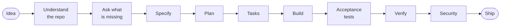

# Spec Driven Development By Ashish Mohanty

**One skill that takes a team from an idea to a shipped, tested feature, in any language.** It reads your repository, asks only what it cannot work out, sets up a proper project structure if you are starting from nothing, and then guides every step of the lifecycle with a person approving each one.



## Install

```bash
npx skills add ashishmohanty-99/spec-driven-development
```

Works with Claude Code, Cursor, Codex, Copilot, Gemini CLI and other agents that support skills. Then say:

> **Set up spec-driven development in this repository.**

That is all. The skill carries its own small tool (Python 3.11+, no other dependencies) and copies it into your project, so teammates and CI need nothing installed.

| Other route | How |
|---|---|
| Claude Code plugin | `/plugin install spec-driven-development-by-ashish-mohanty --marketplace ashishmohanty-99/spec-driven-development` |
| Plugin directory | Submit or install the `plugin/` folder: a documentation-only build with no scripts, which applies the checks by hand ([Manual Mode](skills/spec-driven-development-by-ashish-mohanty/references/Manual-Mode.md)) unless you add the tool |
| By hand | Copy `skills/spec-driven-development-by-ashish-mohanty` into your agent's skills folder (for example `~/.claude/skills/`) |
| claude.ai | `python tools/build_skill.py`, then upload `dist/sdd-skill.zip` at Customize → Skills |
| Python package | `pipx install git+https://github.com/ashishmohanty-99/spec-driven-development`, then `sdd init` |

## What happens when you set it up

1. **It understands your repository.** Languages, frameworks, test tools, CI and protected files are detected from file names and manifests. Secret files are never opened.
2. **It tells you what it found** in a few plain lines.
3. **It asks only what it could not detect**, one question at a time, each with a recommended answer: your test command, where the app runs, the form acceptance tests should take.
4. **It lets you choose your lifecycle.** Every check is on by default. You may switch any optional check off; you are told what that costs, your reason is recorded, and every report reminds the team it is off.
5. **Empty repository?** It proposes a conventional folder structure for your stack, waits for your approval, generates it with the ecosystem's own tooling, and proves that build, lint and a first test pass.
6. **It tells you the next step.** Always. `sdd next` does the same at any time.

## Any language

| Part | How it adapts |
|---|---|
| Understanding the repo | Python, JavaScript/TypeScript, Go, Rust, Java/Kotlin, C#/.NET, Ruby, PHP, Swift and more |
| Building features | The project's own language, test framework and conventions, from the detected profile |
| Acceptance tests from specs | Playwright (Python), Playwright (TypeScript), or Gherkin feature files that run under Cucumber-JVM, Reqnroll, godog, Behat, cucumber-rs, behave and others |
| New project structure | The stack's official generator and community layout |

## Day to day

```text
/sdd-spec "idea"            testable requirements                (you approve)
/sdd-clarify <feature>      close open questions
/sdd-plan <feature>         design mapped to real files          (you approve)
/sdd-tasks <feature>        small traceable tasks                (you approve)
/sdd-build <feature>        one task, test first
/sdd-gen-tests <feature>    acceptance tests from the spec
/sdd-verify <feature>       evidence per requirement
/sdd-ship <feature>         readiness report                     (you merge)
/sdd-next                   what to do now
```

## Ship faster without trusting less

Once the plan is approved, `/sdd-parallel <feature>` runs two tracks at once: the build, and a separate tester agent that writes the acceptance tests from the spec without ever seeing the code. `sdd prove red` records the tests failing before the code exists; `sdd prove green` records the same, unchanged tests passing after. A test that never failed, or was edited to pass, does not count. Details: [Parallel Delivery](skills/spec-driven-development-by-ashish-mohanty/references/Parallel-Delivery.md).

## Security in four layers

```bash
sdd security --strict
```

| Layer | What it checks | Engine |
|---|---|---|
| Secrets | The whole repository and its entire git history | TruffleHog or gitleaks when installed; a built-in scanner otherwise |
| Code scan | Exploitable patterns in your source | semgrep, bandit, gosec, brakeman |
| Dependencies | Known-vulnerable packages | osv-scanner, trivy, pip-audit, npm audit and others |
| Pentest | The running application | Strix, run by a person |

A layer whose tool is not installed reports **NOT RUN**, never clean. Details: [Security Scanning](skills/spec-driven-development-by-ashish-mohanty/references/Security-Scanning.md).

## You choose the checks

| Check | If you switch it off |
|---|---|
| Team rules | No shared rules; reviews are less consistent |
| Open-question gate | Ambiguous requirements get built as guessed |
| Design review | Wrong-layer changes, surprise dependencies, larger diffs |
| Task breakdown | A requirement can be silently left unbuilt |
| Test per requirement | Requirements can ship unproven |
| Generated acceptance tests | No automated proof of user-visible behaviour |
| Red-first proof | Nothing shows the tests can fail, or that they were not edited to pass |
| Secret scanning | A committed key or password goes unnoticed |
| Static code analysis | Injection and similar flaws in the code go unexamined |
| Dependency audit | The app can ship with libraries that have published exploits |
| Independent review | Only the author judges its own work |
| Penetration test | Security-relevant changes ship without being attacked first |

```bash
sdd lifecycle skip plan --reason "two-person prototype, design agreed in person"
```

Writing an approved spec before code is the one step that cannot be switched off. Details: [Lifecycle Options](skills/spec-driven-development-by-ashish-mohanty/references/Lifecycle-Options.md).

## Documentation

The [wiki](https://github.com/ashishmohanty-99/spec-driven-development/wiki) is the manual.

| Page | For |
|---|---|
| [Getting Started](wiki/Getting-Started.md) | Install and first feature |
| [Step-by-Step Workflow](skills/spec-driven-development-by-ashish-mohanty/references/Step-by-Step-Workflow.md) | Every phase: who acts, what to check |
| [Lifecycle Options](skills/spec-driven-development-by-ashish-mohanty/references/Lifecycle-Options.md) | Each optional check and what skipping costs |
| [Project Structure](skills/spec-driven-development-by-ashish-mohanty/references/Project-Structure.md) | Folder structures for new applications |
| [Test Automation](skills/spec-driven-development-by-ashish-mohanty/references/Test-Automation.md) | Acceptance tests from specs, in three forms |
| [Parallel Delivery](skills/spec-driven-development-by-ashish-mohanty/references/Parallel-Delivery.md) | Two independent tracks and red-first proof |
| [Security Scanning](skills/spec-driven-development-by-ashish-mohanty/references/Security-Scanning.md) | The four security layers and how to read them |
| [Penetration Testing](skills/spec-driven-development-by-ashish-mohanty/references/Penetration-Testing.md) | Strix without exposing an API key |
| [Security Model](skills/spec-driven-development-by-ashish-mohanty/references/Security-Model.md) | Threats, controls and their tests |
| [SDD and the AI SDLC](skills/spec-driven-development-by-ashish-mohanty/references/SDD-and-the-AI-SDLC.md) | Why the method exists |
| [CLI Reference](skills/spec-driven-development-by-ashish-mohanty/references/CLI-Reference.md) · [Extending](skills/spec-driven-development-by-ashish-mohanty/references/Extending.md) · [Troubleshooting](skills/spec-driven-development-by-ashish-mohanty/references/Troubleshooting.md) | Reference |

## Security in one paragraph

No command, config field or prompt accepts an API key. The penetration-test step lets Strix read its key from your own environment, or runs keyless against a local model. Child processes get a minimal environment and never a shell. Paths are confined to the project and never written through links. Spec text cannot become code. Committed credentials fail the gates. A scan that did not run exits 3, never 0. Report vulnerabilities privately: [SECURITY.md](SECURITY.md).

## Repository layout

| Path | Contents |
|---|---|
| `skills/spec-driven-development-by-ashish-mohanty/` | **The skill**: `SKILL.md`, the bundled tool under `scripts/`, reference pages under `references/` |
| `…/scripts/specpilot/` | Tool source (Python, standard library only) |
| `…/scripts/specpilot/assets/` | Phase skills, slash commands, subagents, templates and test scaffolding installed into a project |
| `plugin/` | Documentation-only build for plugin directories, generated by `tools/build_plugin.py` |
| `tests/` | Unit and security regression tests (`python -m unittest`) |
| `wiki/` | Home and Getting Started; published to the GitHub wiki with the reference pages |

## Development

```bash
python -m unittest
pip install ruff bandit && ruff check . && bandit -r skills/spec-driven-development-by-ashish-mohanty/scripts/specpilot -c pyproject.toml
```

## Credits

The gated lifecycle and skill format draw on [addyosmani/agent-skills](https://github.com/addyosmani/agent-skills) (MIT). Penetration testing is performed by [Strix](https://github.com/usestrix/strix) (Apache-2.0), installed separately and not included here.

MIT License.
