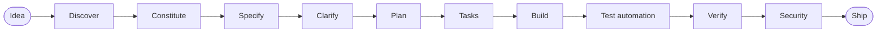

# SpecPilot

**Spec-Driven Development for the AI software lifecycle.** Install it in any repository. It profiles the codebase, then keeps your AI agent inside a gated process: no code without an approved spec, every requirement traced to a task and a test, and security checked before ship.



A human approves at every arrow. The `sdd` CLI checks what can be checked mechanically.

## Install

```bash
pipx install git+https://github.com/ashishmohanty-99/spec-driven-development
cd your-project
sdd init          # add --agent generic for Codex, Cursor, Copilot, Gemini
sdd audit
```

Python 3.9+. The CLI uses the standard library only.

## Use

```text
/sdd-init                       learn the codebase
/sdd-constitution               rules for every change        (you ratify)
/sdd-spec "idea"                testable requirements         (you approve)
/sdd-clarify <feature>          close open questions
/sdd-plan <feature>             design mapped to real files   (you approve)
/sdd-tasks <feature>            small traceable tasks         (you approve)
/sdd-build <feature>            one task, test first
/sdd-gen-tests <feature>        browser tests from the spec
/sdd-verify <feature>           evidence per requirement
/sdd-ship <feature>             readiness report              (you merge)
```

```bash
sdd status                                # where every feature is
sdd verify --strict                       # traceability and approval gates
sdd regression --strict                   # unit + e2e + gates, one exit code
sdd pentest --target . --authorized       # guarded Strix scan
```

## Documentation

The [wiki](https://github.com/ashishmohanty-99/spec-driven-development/wiki) is the manual (source in [`wiki/`](wiki/)):

| Page | For |
|---|---|
| [Getting Started](wiki/Getting-Started.md) | Install and first feature |
| [SDD and the AI SDLC](wiki/SDD-and-the-AI-SDLC.md) | Why the process exists |
| [Step-by-Step Workflow](wiki/Step-by-Step-Workflow.md) | Every phase: who acts, what to check |
| [Test Automation](wiki/Test-Automation.md) | Spec → pytest-playwright tests |
| [Penetration Testing](wiki/Penetration-Testing.md) | Strix without exposing an API key |
| [Security Model](wiki/Security-Model.md) | Threats, controls, tests |
| [CLI Reference](wiki/CLI-Reference.md) · [Extending](wiki/Extending.md) · [Troubleshooting](wiki/Troubleshooting.md) | Reference |

## Security in one paragraph

No command, config field or prompt accepts an API key. The pentest step lets Strix read `LLM_API_KEY` from your own environment, or runs keyless against a local model. Child processes get a minimal environment, never a shell. Paths are confined to the project root and never written through symlinks. Spec text cannot become code. `sdd audit` and `sdd verify` fail on committed credentials. A scan that did not run exits 3, never 0. Details and the test for each control: [Security Model](wiki/Security-Model.md). Report vulnerabilities privately: [SECURITY.md](SECURITY.md).

## Repository layout

| Path | Contents |
|---|---|
| `specpilot/` | CLI: `scan`, `spec` (gates), `gentests`, `regression`, `pentest`, `audit`, `security` |
| `specpilot/assets/` | Skills, slash commands, subagents, templates, e2e connector |
| `tests/` | Unit and security regression tests (`python -m unittest`) |
| `wiki/` | Documentation, published to the GitHub wiki |

## Development

```bash
python -m unittest
pip install ruff bandit && ruff check . && bandit -r specpilot -c pyproject.toml
```

## Credits

The gated lifecycle and skill format draw on [addyosmani/agent-skills](https://github.com/addyosmani/agent-skills) (MIT). Penetration testing is performed by [Strix](https://github.com/usestrix/strix) (Apache-2.0), which is installed separately and not included here.

MIT License.
