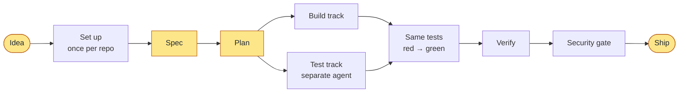

# Spec Driven Development By Ashish Mohanty

**One skill that takes a team from an idea to a shipped, tested, security-checked feature, in any language.** A person decides what gets built and approves each step. An AI agent does the work in between. A small tool called `sdd` checks everything a machine can check, so nobody has to take the agent's word for it.



Yellow steps need a person's approval. Everything else runs between approvals.

## Contents

- [The process at a glance](#the-process-at-a-glance)
- [The real process, step by step](#the-real-process-step-by-step)
- [What actually runs underneath](#what-actually-runs-underneath)
- [Security: what is and is not checked](#security-what-is-and-is-not-checked)
- [You choose the checks](#you-choose-the-checks)
- [Documentation](#documentation)

## The process at a glance

Steps 1 to 3 happen once. Steps 4 to 11 repeat for every feature. The wiki uses the same numbers and names.

| Step | Name | When | You | Result |
|---|---|---|---|---|
| 1 | Install the skill | Once per machine | Run one command | The skill is available to your agent |
| 2 | Set up the repository | Once per repository | Answer a few questions | Profile, config and the tool in `.sdd/` |
| 3 | Agree team rules | Once per repository | Ratify | `.sdd/constitution.md` |
| 4 | Write the spec | Every feature | Describe the idea | `spec.md` (draft) |
| 5 | Clarify and approve | Every feature | **Approve** | `spec.md` (approved) |
| 6 | Plan | Every feature | **Approve** | `plan.md` with a Test contract |
| 7 | Tasks | Every feature | **Approve** | `tasks.md` |
| 8 | Build and test in parallel | Every feature | Review each task | Code, acceptance tests, red → green proof |
| 9 | Verify | Every feature | Decide on findings | `verification.md` |
| 10 | Security gate | Every feature | Run the pentest, triage | Gate result per layer |
| 11 | Ship | Every feature | **Merge** | Released feature |

## The real process, step by step

Each step shows what **you** do, what the **agent** does, and what the **tool** checks. Commands starting with `/` are typed to the agent; commands starting with `sdd` run in a terminal. Once the tool is copied into your project, `sdd` means `python3 .sdd/bin/sdd.py`.

### Step 1: Install the skill

```bash
npx skills add ashishmohanty-99/spec-driven-development
```

This works for Claude Code, Cursor, Codex, Copilot, Gemini CLI and other agents that support skills. You need Python 3.11 or newer; the tool has no other dependencies.

| Other route | How |
|---|---|
| Claude Code plugin | `/plugin install spec-driven-development-by-ashish-mohanty --marketplace ashishmohanty-99/spec-driven-development` |
| claude.ai | Run `python tools/build_skill.py`, then upload `dist/sdd-skill.zip` at Customize → Skills |
| By hand | Copy `skills/spec-driven-development-by-ashish-mohanty` into your agent's skills folder |
| Python package | `pipx install git+https://github.com/ashishmohanty-99/spec-driven-development` |
| Plugin directory | The `plugin/` folder: documentation only, no tool. The agent applies the checks by hand ([Manual Mode](skills/spec-driven-development-by-ashish-mohanty/references/Manual-Mode.md)) |

### Step 2: Set up the repository

| | |
|---|---|
| **You say** | "Set up spec-driven development in this repository." |
| **Agent runs** | `sdd init --vendor` |
| **Tool does** | Reads file names and manifests (never secret files). Detects languages, frameworks, test tools and CI. Installs the phase skills and commands. Copies itself to `.sdd/bin/` so teammates and CI need nothing installed. Adds `.env`, key files and scan output to `.gitignore` |
| **Agent then** | Tells you what it found and asks up to five questions, one at a time, each with a recommended answer |
| **You decide** | Your test command, where the app runs, the form of acceptance tests, and which checks to keep |
| **Produces** | `.sdd/codebase-profile.md`, `.sdd/config.json` |

In an empty repository the agent also proposes a folder structure for your stack, waits for your approval, generates it with the ecosystem's own tooling, and shows that build, lint and one test pass.

### Step 3: Agree team rules

| | |
|---|---|
| **You type** | `/sdd-constitution` |
| **Agent does** | Drafts a short list of checkable rules from what your repository and CI already enforce |
| **You do** | Edit it, then change `Status: draft` to `Status: ratified` yourself |
| **Produces** | `.sdd/constitution.md` |

### Step 4: Write the spec

| | |
|---|---|
| **You type** | `/sdd-spec "Lock an account for 15 minutes after 5 failed logins"` |
| **Agent does** | Searches your code, then writes testable requirements with permanent ids (`REQ-001`), what is out of scope, abuse cases for anything security-relevant (`REQ-S01`), and a Given/When/Then scenario per requirement. Anything it cannot confirm is marked `[NEEDS CLARIFICATION]` instead of guessed |
| **Produces** | `.sdd/specs/login-lockout/spec.md` with `Status: draft` |

### Step 5: Clarify and approve

| | |
|---|---|
| **You type** | `/sdd-clarify login-lockout` |
| **Agent does** | Answers what the code can answer, asks you the rest (five at most), records each decision |
| **You do** | Change `Status: draft` to `Status: approved`. The agent is not allowed to |
| **Tool checks** | `sdd verify login-lockout`: no open questions, no placeholder text, no duplicate ids |

### Step 6: Plan

| | |
|---|---|
| **You type** | `/sdd-plan login-lockout` |
| **Agent does** | Reads the code without changing it. Writes the approach and the rejected alternative, the exact files to touch, a table mapping every requirement to where it is satisfied, risks with rollback, and a **Test contract**: the routes, labels and ids the tests may rely on |
| **You do** | Approve, paying attention to new dependencies, migrations and public API changes |
| **Produces** | `plan.md` |

### Step 7: Tasks

| | |
|---|---|
| **You type** | `/sdd-tasks login-lockout` |
| **Agent does** | Breaks the plan into small tasks, each naming the requirements it covers: `- [ ] T-001 Count failed attempts (covers: REQ-001)` |
| **Tool checks** | Every requirement is covered; no task is unlinked |
| **You do** | Approve the list |

### Step 8: Build and test in parallel

| | |
|---|---|
| **You type** | `/sdd-parallel login-lockout` (or `/sdd-build login-lockout` for one track at a time) |
| **Test track** | A separate tester agent, which never reads the implementation, runs `sdd gen-tests login-lockout` to turn the spec's scenarios into acceptance tests, then `sdd prove red login-lockout`. The tests must **fail**, and that is recorded |
| **Build track** | The builder implements one task at a time: failing unit test, minimal code, project checks, one commit, tick the task. It may not edit the acceptance tests |
| **Join** | `sdd prove green login-lockout`. The **same, unchanged** test file must now pass. If it was edited since the red run, the tool refuses |
| **Produces** | Code, `tests/e2e/…`, `evidence.json` |

### Step 9: Verify

| | |
|---|---|
| **You type** | `/sdd-verify login-lockout` |
| **Tool runs** | `sdd regression --strict`: your own tests, the acceptance tests, the gates for every feature, and the security gate |
| **Agent does** | Writes a table of requirement → test → result, and has an independent reviewer agent read the diff against the spec |
| **You do** | Decide on each finding |
| **Produces** | `verification.md` |

### Step 10: Security gate

| | |
|---|---|
| **Tool runs** | `sdd security --strict`: secrets across the repository and its whole git history, code scan, dependency audit |
| **You run** | The penetration test, in your own terminal: `sdd pentest --target . --authorized`. The agent never sees your model key |
| **Agent does** | Triages findings with you: fix, accept the risk with a named owner, or show it is a false positive |

### Step 11: Ship

| | |
|---|---|
| **You type** | `/sdd-ship login-lockout` |
| **Agent does** | Assembles the evidence, a rollout and rollback plan, the list of any checks your team switched off, and the pull request text |
| **You do** | Merge and deploy. The agent does not |

At any point, `sdd next` tells you the single next action for every feature.

## What actually runs underneath

| Command | What it really does | Reliability |
|---|---|---|
| `sdd init`, `scan` | Reads names and manifests, writes the profile and config | Deterministic code, tested |
| `sdd verify` | Parses the spec, plan and tasks files and applies fixed rules: approval order, coverage, traceability, proof, secrets | Deterministic code, tested |
| `sdd gen-tests` | Converts each scenario line into a test in your stack's form: Playwright (Python or TypeScript) or a Gherkin feature file | Deterministic code. Python and TypeScript forms were run in a real browser; Gherkin output is checked for structure only |
| `sdd prove` | Runs the feature's tests and records pass or fail with a hash of the test file | Deterministic code, run end to end in a real browser |
| `sdd regression` | Runs your test command, the acceptance tests, every gate, and the security gate | Deterministic code, tested |
| `sdd security` | See the next section | Mixed: see below |
| `/sdd-*` commands and skills | Instructions the agent follows | As reliable as the agent. This is why the gates above exist |

Human approval is a convention, not a lock: the tool checks that the status line says `approved`, and the skills forbid the agent from writing it, but nothing physically stops a person or agent from editing a text file. Review the status changes in your pull requests.

## Security: what is and is not checked

`sdd security` runs four separate layers. Each reports **clean**, **findings**, **error** or **NOT RUN**. A layer that did not run is unknown, never clean.

| Layer | Question it answers | What runs | State of this integration |
|---|---|---|---|
| Secrets | Is a key or password in the repository, now or in any past commit? | TruffleHog if installed, else gitleaks if installed, else the built-in scanner | Built-in scanner: real, run on this repository. TruffleHog and gitleaks hand-off: written to their documented interfaces and tested with stand-in programs only, not yet with the real tools |
| Code scan | Does the source contain exploitable patterns? | semgrep, bandit, gosec or brakeman, whichever fits your stack and is installed | Tested with stand-ins only. Nothing is bundled: with none installed, the layer is NOT RUN |
| Dependencies | Do third-party packages have known vulnerabilities? | osv-scanner, trivy, pip-audit, npm audit, cargo-audit, govulncheck or bundle-audit | Tested with stand-ins only. With none installed, the layer is NOT RUN |
| Pentest | Can the running application be attacked? | [Strix](https://github.com/usestrix/strix), run by you | Wrapper tested with a stand-in. No real scan has been run |

**A "stand-in"** is a small fake program used in the tests that pretends to be the real tool. It proves this project reads that tool's output correctly. It does not prove the real tool behaves as documented, so the first run with each real tool is the true test.

**On matching TruffleHog:** the built-in scanner covers every tracked file and every line ever added in git history, with about 55 detectors. TruffleHog has several hundred and can check whether a key is still live. To get TruffleHog's coverage, install TruffleHog; the gate then runs it for you. Live verification stays off unless you pass `--verify-live`.

**What no scanner here does:** find flaws in your business logic. That is why the spec carries abuse cases (`REQ-S01`) that become negative tests, and why the penetration test exists.

To make the code and dependency layers do real work, install one tool for each:

| Stack | Code scan | Dependencies |
|---|---|---|
| Any | semgrep | osv-scanner or trivy |
| Python | bandit | pip-audit |
| JavaScript / TypeScript | semgrep | npm audit |
| Go | gosec | govulncheck |
| Ruby | brakeman | bundle-audit |
| Rust | semgrep | cargo-audit |

## You choose the checks

Every check is on by default. Any optional check can be switched off. You are told what that costs, your reason is recorded, and every report repeats that it is off.

| Check | If you switch it off |
|---|---|
| Team rules | No shared rules; reviews are less consistent |
| Open-question gate | Ambiguous requirements get built as guessed |
| Design review | Wrong-layer changes, surprise dependencies, larger diffs |
| Task breakdown | A requirement can be silently left unbuilt |
| Test per requirement | Requirements can ship unproven |
| Generated acceptance tests | No automated proof of user-visible behaviour |
| Red-first proof | Nothing shows the tests can fail, or that they were not edited to pass |
| Secret scanning | A committed key or password goes unnoticed |
| Static code analysis | Injection and similar flaws in the code go unexamined |
| Dependency audit | The app can ship with libraries that have published exploits |
| Independent review | Only the author judges its own work |
| Penetration test | Security-relevant changes ship without being attacked first |

```bash
sdd lifecycle skip plan --reason "two-person prototype, design agreed in person"
```

Approving a spec before code is the one step that cannot be switched off.

## Add it to CI

```yaml
permissions:
  contents: read
steps:
  - uses: actions/checkout@v4
    with:
      fetch-depth: 0          # full history, so past commits are scanned for secrets
  - uses: actions/setup-python@v5
    with:
      python-version: "3.13"
  - run: python3 .sdd/bin/sdd.py verify --strict
  - run: python3 .sdd/bin/sdd.py security --strict
```

`security --strict` fails while the code-scan or dependency layer has no tool installed. Install one in an earlier step, or switch that layer off with a recorded reason.

## Documentation

The [wiki](https://github.com/ashishmohanty-99/spec-driven-development/wiki) is the manual.

| Page | For |
|---|---|
| [Getting Started](wiki/Getting-Started.md) | A complete worked example, from install to ship |
| [Step-by-Step Workflow](skills/spec-driven-development-by-ashish-mohanty/references/Step-by-Step-Workflow.md) | Every phase: who acts, what to check |
| [Parallel Delivery](skills/spec-driven-development-by-ashish-mohanty/references/Parallel-Delivery.md) | Two independent tracks and red-first proof |
| [Test Automation](skills/spec-driven-development-by-ashish-mohanty/references/Test-Automation.md) | Acceptance tests from specs, in three forms |
| [Security Scanning](skills/spec-driven-development-by-ashish-mohanty/references/Security-Scanning.md) | The four layers and how to read them |
| [Penetration Testing](skills/spec-driven-development-by-ashish-mohanty/references/Penetration-Testing.md) | Strix without exposing an API key |
| [Lifecycle Options](skills/spec-driven-development-by-ashish-mohanty/references/Lifecycle-Options.md) | Each optional check and what skipping costs |
| [Project Structure](skills/spec-driven-development-by-ashish-mohanty/references/Project-Structure.md) | Folder structures for new applications |
| [Security Model](skills/spec-driven-development-by-ashish-mohanty/references/Security-Model.md) | How the tool itself is protected |
| [SDD and the AI SDLC](skills/spec-driven-development-by-ashish-mohanty/references/SDD-and-the-AI-SDLC.md) | Why the method exists |
| [CLI Reference](skills/spec-driven-development-by-ashish-mohanty/references/CLI-Reference.md) · [Extending](skills/spec-driven-development-by-ashish-mohanty/references/Extending.md) · [Troubleshooting](skills/spec-driven-development-by-ashish-mohanty/references/Troubleshooting.md) · [Manual Mode](skills/spec-driven-development-by-ashish-mohanty/references/Manual-Mode.md) | Reference |

## Repository layout

| Path | Contents |
|---|---|
| `skills/spec-driven-development-by-ashish-mohanty/` | **The skill**: `SKILL.md`, the bundled tool under `scripts/`, reference pages under `references/` |
| `…/scripts/specpilot/` | Tool source (Python, standard library only) |
| `…/scripts/specpilot/assets/` | Phase skills, slash commands, subagents, templates and test scaffolding installed into a project |
| `plugin/` | Documentation-only build for plugin directories, generated by `tools/build_plugin.py` |
| `tests/` | Unit and security regression tests (`python -m unittest`) |
| `wiki/` | Home and Getting Started; published to the GitHub wiki with the reference pages |

## Development

```bash
python -m unittest
```

```bash
pip install ruff bandit && ruff check . && bandit -r skills/spec-driven-development-by-ashish-mohanty/scripts/specpilot -c pyproject.toml
```

```bash
python tools/build_plugin.py
```

Report vulnerabilities privately: [SECURITY.md](SECURITY.md).

## Credits

The gated lifecycle and skill format draw on [addyosmani/agent-skills](https://github.com/addyosmani/agent-skills) (MIT). Penetration testing is performed by [Strix](https://github.com/usestrix/strix) (Apache-2.0), installed separately and not included here.

MIT License.
