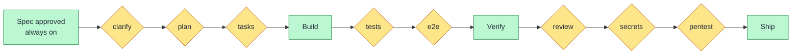

# Lifecycle Options

Every check is on by default. A team may switch any optional check off; the tool states what that costs, records the reason, and repeats the warning on every report. One step cannot be switched off: **a person approves a spec before code is written**. That step is the method.



Green always happens. Yellow is your choice.

## The checks

| Check | What it gives you | If you switch it off |
|---|---|---|
| `constitution` Team rules | A short, ratified list of rules every change must follow | No shared rules: the agent falls back to conventions it detects, and reviews are less consistent |
| `clarify` Open-question gate | A spec cannot be built while it has unresolved questions | Ambiguous requirements get built as the agent guessed them. Expect rework |
| `plan` Design review | A design mapped to real files is approved before tasks | No design review before code: wrong-layer changes, surprise dependencies, larger diffs |
| `tasks` Task breakdown | Every requirement is covered by a small, ordered task | A requirement can be silently left unbuilt, and progress cannot be tracked |
| `tests` Test per requirement | A finished requirement must be named by a real test | Requirements can ship unproven. Nothing ties "done" to evidence |
| `e2e` Generated acceptance tests | End-to-end tests generated from the spec and run | No automated proof of user-visible behaviour; regressions surface in production |
| `secrets` Secret scanning | Specs, tests and agent files are scanned for credentials | A committed key or password goes unnoticed |
| `review` Independent review | A second reader checks the diff against the spec | Only the author judges its own work |
| `pentest` Penetration test | Security-relevant changes need a scan record before ship | Auth, input and endpoint changes ship without anyone attacking them first |

## How to change them

```bash
sdd lifecycle
```

```bash
sdd lifecycle skip plan --reason "two-person prototype, design agreed in person"
```

```bash
sdd lifecycle enable plan
```

Skipping prints a warning and needs a reason a teammate can read later. The reason and date are stored in `.sdd/config.json`, which is committed, so the decision is visible in review.

## What you will see afterwards

Every `sdd status`, `sdd verify`, `sdd regression` and `sdd next` ends with:

```text
Switched off by the team (not checked):
  ! Design review [plan]: No design review before code: wrong-layer changes, surprise dependencies and larger diffs.  Reason given: two-person prototype, design agreed in person
```

The ship report repeats the same list, so whoever merges knows what was not checked.

## Suggested starting points

| Situation | Reasonable to switch off | Keep on |
|---|---|---|
| Solo prototype or spike | `plan`, `review`, `pentest`, `constitution` | `tests`, `secrets` |
| Small team, internal tool | `pentest` (if not exposed), `review` | `clarify`, `tasks`, `tests`, `secrets` |
| Library or CLI with no UI | `e2e` | everything else |
| Production product | nothing | everything |

The agent never switches a check off on its own. It will tell you what a check costs and ask for your reason.
