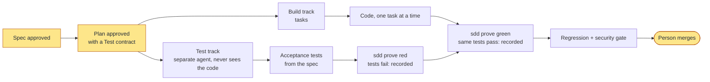
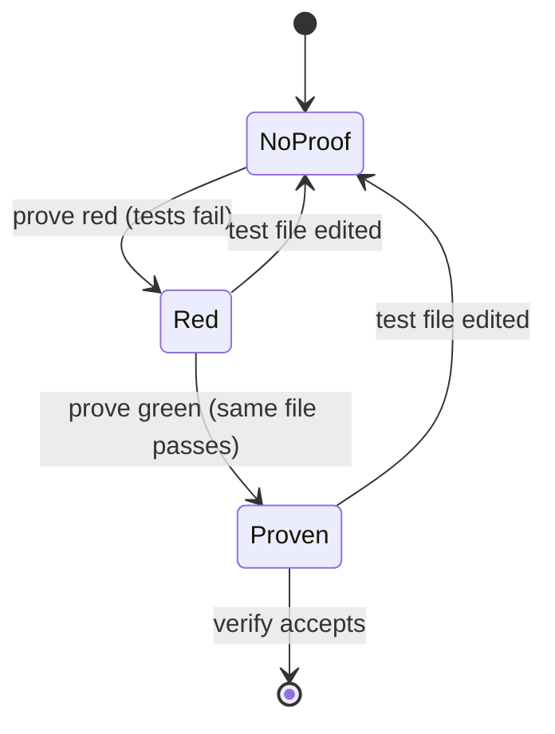

# Parallel Delivery

Once a spec is approved, the tests do not depend on the code. Building and testing can start together, from the same documents, and meet at the end.



## Why two agents

When one agent writes the code and its tests, the tests tend to describe what was built. A tester that sees only the spec and the contract writes tests for what was asked. That is the same reason a developer does not approve their own pull request.

| Role | Reads | Writes | Never |
|---|---|---|---|
| Tester (`acceptance-tester`) | Spec, the plan's Test contract, the test folder | Acceptance tests and steps | Reads or edits implementation source |
| Builder | Everything | Source, unit tests, `tasks.md` | Edits the feature's acceptance tests or its evidence |
| You | Everything | Approvals | |

## The Test contract

Both tracks need to agree on what the tests may rely on. It is a section of `plan.md`, approved with the plan:

| Element | Value |
|---|---|
| Sign-in page | `/login` |
| Password field | label "Password" |
| Submit button | name "Sign in" |
| Error message | text "Invalid email or password" |
| Lockout response | HTTP 423 with `{"error": "locked"}` |

## Red-first proof

A test that has never failed proves nothing, and a test edited after it failed may have been edited to pass. Two commands make both checkable.

```bash
sdd prove red login-lockout
```

Run before the code exists. The tests must **fail**; the tool records the time and a hash of the test file. If they pass, nothing is recorded.

```bash
sdd prove green login-lockout
```

Run after the build. The tests must **pass**, and the test file must be identical to the one recorded at red. If it changed, the tool refuses and asks for a new red run.



`sdd verify` checks the record: once every task is done, a feature with acceptance tests needs a valid red and green. Without `--strict` this is a warning; with `--strict`, or once the spec is marked shipped, it is an error.

## When the tests really are wrong

The spec was unclear, or the contract changed. Use `/sdd-sync`: change the spec or the contract with a person's approval, regenerate the tests, record red again. The proof then covers the corrected tests.

## How to run it

```text
/sdd-parallel login-lockout
```

The agent starts the tester for the test track, runs the build track itself, and joins them with the green run. `sdd next` shows the parallel step whenever one is available.

## The regression suite

Generated tests live in the acceptance-test folder, and `sdd regression` runs everything in it. A shipped feature's tests are part of the suite from then on, with no separate step.

## What stays with you

Spec approval, plan approval, the task list and the merge. Parallel delivery removes the waiting between those points. It does not remove the points.

## Limits

- The red run can fail for the wrong reason, such as the app not running. The tester is told to check why it failed; the tool only knows that it did.
- The proof is per feature, not per requirement.
- Switching off the `red-first` or `e2e` check removes this gate. `sdd lifecycle` shows the cost.
