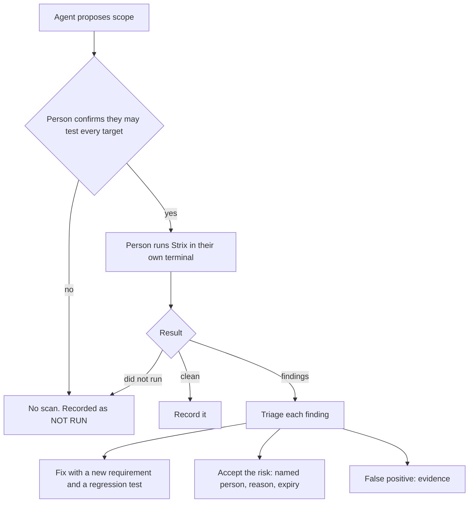

# Penetration Testing

Security-relevant changes (sign-in, permissions, input handling, new endpoints) should be attacked before they ship. This method uses [Strix](https://github.com/usestrix/strix), an open-source AI penetration-testing agent, and treats its result as a gate.

## The rule about credentials

The agent never asks for, receives, stores or prints a model key. A person runs the scan in their own terminal, where their own settings live. The safest setup uses a local model, so no key exists at all. Follow Strix's own documentation for installing it and for choosing a model provider.

## How it works

## Steps

1. **Scope.** The agent lists the targets: a folder in this repository, or a deployed environment. A deployed host is scanned only if a person authorised to test it says so. Never scan a system the team does not own.
2. **Depth.** A quick scan limited to the change for a pull request; a standard scan for a release; a deep scan for a periodic audit.
3. **Run.** The person runs the scan. With the `sdd` tool installed, `sdd pentest --target . --authorized` adds the safety checks (allow-listed hosts, validated arguments, redacted output). Without it, the person runs Strix directly as its documentation describes.
4. **Read the result honestly.** A scan that did not run is unknown, not clean. Report it as NOT RUN.
5. **Triage.** Reports can describe how to attack the application: keep them out of git and treat them as confidential. Each finding is fixed, risk-accepted by a named person, or shown to be a false positive.
6. **Record** scope, date, result and each finding's disposition in the feature's `verification.md`, with no payloads or secrets.

## Switching this check off

A team may switch the penetration-test check off. The consequence is that sign-in, input-handling and endpoint changes ship without anyone attacking them first. The reason is recorded and repeated on every report.
