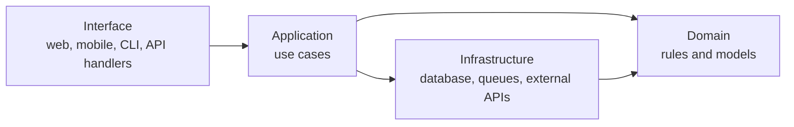

# Project Structure

For a new application, the `project-scaffold` skill agrees a layout with you and creates it with the stack's own tooling. This page gives the principles and the conventional starting tree for common stacks. They are starting points: the ecosystem's current official generator always wins over this page.

## Principles that hold in every language

| Principle | In practice |
|---|---|
| One obvious home for everything | Source, tests, config, scripts and docs are separate top-level areas |
| Organise by feature or domain | `orders/`, `billing/` rather than only `controllers/`, `utils/` |
| Dependencies point inward | UI and transport depend on domain logic, never the reverse |
| Tests mirror source | Unit tests beside or mirroring the code; acceptance tests in `tests/e2e/` |
| Configuration from the environment | `.env.example` lists names only; real values never enter the repository |
| Generated code is fenced off | Its own folder, marked "do not edit" |



## What every repository gets, whatever the stack

```text
.
├── .sdd/                  specs, team rules, codebase profile, the sdd tool
├── .github/workflows/     CI: build, lint, test, sdd gates
├── docs/                  architecture notes and decisions
├── tests/e2e/             acceptance tests generated from specs
├── .env.example           variable names, no values
├── .gitignore
└── README.md              install, run, test
```

## Conventional starting trees

### Web front end (React, Vue, Svelte, Angular with TypeScript)
```text
src/
├── app/                   routing, providers, entry point
├── features/<feature>/    components, hooks, state, api for one feature
├── shared/                ui kit, utilities used by several features
└── assets/
tests/e2e/
public/
```

### API or service (Node, Python, Go, Java, C#, Ruby, PHP, Rust)
```text
src/                       (or the language's standard: cmd/ + internal/ in Go, src/main/java in Java)
├── api/                   routes, controllers, request/response schemas
├── domain/<area>/         business rules and models
├── services/              use cases
├── infrastructure/        database, messaging, external clients
└── config/
tests/
├── unit/
├── integration/
└── e2e/
migrations/
```

| Stack | Generator | Notes |
|---|---|---|
| Node / TypeScript | `npm create vite@latest`, `npx create-next-app`, `nest new` | `src/` + `tests/`; one package manager lockfile |
| Python | `uv init` or `poetry new` | `src/<package>/` layout, `tests/`, `pyproject.toml` |
| Go | `go mod init` | `cmd/<app>/main.go`, `internal/`, `pkg/` only for public libraries |
| Java / Kotlin | Spring Initializr, `gradle init` | `src/main/java`, `src/test/java`, package by feature |
| C# / .NET | `dotnet new sln`, `dotnet new webapi` | `src/<Project>/`, `tests/<Project>.Tests/`, one solution file |
| Rust | `cargo new` | `src/`, `tests/` for integration tests, workspace for several crates |
| Ruby | `rails new` | Rails conventions as generated |
| PHP | `composer create-project laravel/laravel` | Framework conventions as generated |

### Mobile (Flutter, React Native, Swift, Kotlin)
```text
lib/ or src/
├── features/<feature>/    screens, state, data for one feature
├── core/                  navigation, theme, networking
└── shared/
test/                      unit and widget tests
integration_test/ or e2e/
```

### Command-line tool or library
```text
src/<name>/                commands/ for a CLI; public modules for a library
tests/
docs/
examples/
```

### Full stack or several services (monorepo)
```text
apps/
├── web/
└── api/
packages/                  shared types, ui kit, clients
infra/                     deployment and infrastructure as code
tests/e2e/                 acceptance tests across the whole system
```

## A scaffold is finished when

- [ ] dependencies install from a clean checkout
- [ ] the build or type-check passes
- [ ] one real test passes with the stack's standard test framework
- [ ] lint and format run clean
- [ ] CI runs all of the above
- [ ] `README.md` tells a new teammate how to run it
