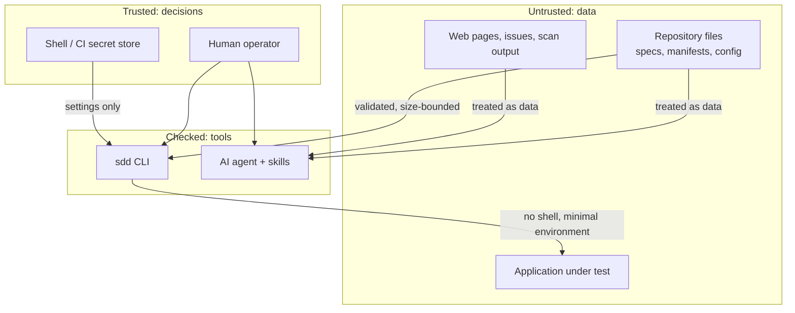

# Security Model

SpecPilot runs inside repositories it does not control, next to an AI agent that can be steered by text in those repositories. This page states what it defends against and how each defence is tested.

## Trust boundaries

## Threats and controls

| # | Threat | Control | Test |
|---|---|---|---|
| 1 | **API key leaks** through chat, a file, shell history or logs | No flag, config field or prompt accepts a key. Strix reads it from the person's own shell. Output redacted. Keyless local-model path documented first | `test_there_is_no_way_to_pass_a_key…`, `test_real_run_redacts_key…` |
| 2 | **Key sent in clear text** | Refuses a key with an unencrypted remote API address, or a base URL with embedded credentials | `test_model_env_rules` |
| 3 | **Unrelated secrets reach child processes** | Tests and scans start with an allow-listed environment; cloud keys, tokens and the rest are dropped | `test_real_run_redacts_key_and_limits_environment` |
| 4 | **Secrets committed** in specs, tests, config or agent files | `sdd verify` and `sdd audit` detect token shapes, credential assignments, JWTs and credentials in URLs, and report the location, never the value. `init` adds `.env`, keys and scan output to `.gitignore` | `test_verify_and_audit_fail_on_committed_secret`, `test_06_common_credential_forms_are_detected_without_false_positives`, `test_07_file_cap_does_not_hide_secrets_or_tests_in_large_repositories` |
| 4a | **Secrets elsewhere in the code or in old commits** | `sdd security` scans every file git knows and every line ever added, using TruffleHog or gitleaks when installed. Values are never printed; findings carry a fingerprint | `test_whole_working_tree_is_scanned_not_just_sdd_files`, `test_git_history_is_scanned_after_the_secret_was_deleted`, `test_values_never_appear_in_reports` |
| 4b | **A missing scanner read as a clean result** | Each layer reports NOT RUN when no tool ran; `--strict` fails on it | `test_clean_repo_reports_missing_tools_as_not_run_never_as_clean`, `test_strict_mode_fails_when_an_enabled_layer_did_not_run` |
| 4c | **Tests written or edited to pass** | Red-first proof: a failing run is recorded before the code, and the passing run must use the identical test file | `test_red_then_green_with_unchanged_tests_is_proof`, `test_green_without_red_and_edited_tests_are_refused` |
| 5 | **Path traversal** via feature names or config | Feature names are strict kebab-case. Every path is resolved and confined to the project root | `test_feature_names_cannot_traverse`, `test_config_cannot_redirect_outside_root` |
| 6 | **Symlink and hard-link attacks** on files the tool writes | Never writes through a symlink or a hard link; scans never follow symlinks | `test_safe_join_and_symlink_writes`, `test_init_does_not_write_through_symlinked_instruction_file`, `test_24_hard_links_sensitive_files_and_name_coverage` |
| 7 | **Command injection** | No shell anywhere. Arguments are lists. Pentest values are validated and passed as single `--flag=value` tokens | `test_pentest_arguments_cannot_inject_options`, `test_runs_configured_command_without_shell` |
| 8 | **Code injection through a spec** into generated tests | Spec text reaches code only via `repr()`, always an inert string literal | `test_spec_text_cannot_become_code` |
| 9 | **Prompt injection**: repository text instructing the agent | Skills state that repository, web and scan text is data. Only script *names* from `package.json` enter agent instructions, never bodies. File and directory names are reduced to one inert line before they reach the profile | `test_package_json_script_bodies_are_not_copied`, `test_08_directory_names_cannot_inject_instructions_into_the_profile` |
| 10 | **Unauthorised scanning** of third-party systems | URL hosts must be allow-listed by a human in config; `--authorized` required; agent told never to edit the list | `test_url_must_be_allow_listed_by_config` |
| 11 | **Something that did not run reported as a pass** | A scan that did not run exits 3 with the words NOT RUN and fails `sdd regression`. Only Strix's "clean" and "findings" results pass through; any other exit, a signal or a timeout is an error. A configured test command that cannot start is a failure, not a skip | `test_not_run_is_exit_3_never_0`, `test_gate_failure_and_unrun_pentest_fail_the_sweep`, `test_18_only_clean_and_findings_pass_through`, `test_17_timeout_is_enforced_while_output_stays_open`, `test_01_missing_runner_fails_instead_of_skipping` |
| 12 | **Reading secret files** during profiling | Scanner reads names plus a fixed list of manifests. `.env`, keys and credential files are listed as protected and never opened | `test_detects_stack_and_never_reads_secrets` |
| 13 | **Resource exhaustion** from huge files or trees | 1 MB read limit, 5,000-file and depth-6 walk limits, subprocess timeouts that stop the whole process group | `test_07_file_cap_does_not_hide_secrets_or_tests_in_large_repositories`, `test_17_timeout_is_enforced_while_output_stays_open` |
| 14 | **CI token abuse** | Workflows declare `permissions: contents: read`. `sdd audit` flags missing permissions and `pull_request_target` with secrets | `test_audit_clean_after_init_and_flags_bad_config_and_ci` |
| 15 | **Supply chain** | The CLI has zero third-party runtime dependencies. Strix is installed separately by you, not vendored. A copy of the CLI in `.sdd/bin` is only used and trusted if it is byte-identical to the installed version | `test_15_foreign_launcher_is_not_advertised_and_is_scanned`, `test_25c_vendor_always_refreshes_the_whole_copy` |
| 16 | **Gates weakened quietly** by a broken config, a mis-named folder or a placeholder test | An unreadable or mistyped `.sdd/config.json` stops every command. Feature folders the gates cannot address are errors. Generated placeholder tests do not count as proof, and a test only proves a requirement of its own feature | `test_11_malformed_config_is_an_error_not_silently_defaults`, `test_10_feature_directories_with_invalid_names_fail_the_gate`, `test_generated_tests_satisfy_strict_traceability`, `test_04_one_features_test_does_not_prove_another_features_requirement` |
| 17 | **Scan details leaking into git** | The pentest record keeps the target without its query string and never stores the instruction text. `sdd audit` scans `.sdd/security/` | `test_09_record_holds_no_instruction_text_or_query_string` |
| 18 | **Upgrades destroying team decisions** | `init --force` refreshes skills, commands, subagents and templates only. The constitution, extensions, e2e connector, config and specs are never overwritten | `test_05_force_never_overwrites_team_owned_files` |

## Handling a leaked key

1. Revoke it at the provider now. Do not wait to confirm misuse.
2. Create a new key with a spending limit.
3. If it was committed, removing the line is not enough: the history still has it. Rotate first, then clean history.
4. Run `sdd audit`.

## What SpecPilot does not do

- It does not make an insecure application secure. It makes sure someone looked, and that the result is recorded.
- Secret detection is pattern-based: it catches common shapes, not every possible credential.
- It cannot stop a human from pasting a key into chat. The skills tell the agent to refuse it and ask for rotation.
- It has been reviewed by an automated second reader and by static analysis, not by an independent human security team.
- `--instruction` text is passed to Strix as a command-line argument, which other users on the same machine can see. Do not put passwords in it.

## Reporting a vulnerability

Use GitHub's private vulnerability reporting on the repository. Do not open a public issue.
