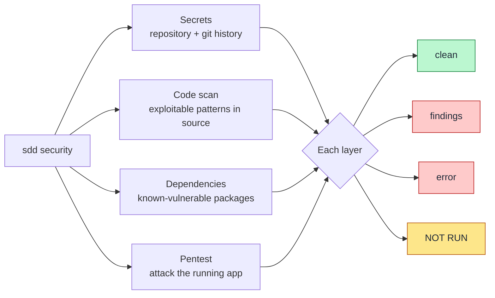

# Security Scanning

`sdd security` is one gate over four layers. They answer different questions, and passing one says nothing about the others.



| Layer | Finds | Does not find |
|---|---|---|
| Secrets | Keys, tokens and passwords committed now or at any time in the past | Flaws in how the code works |
| Code scan | Injection, unsafe deserialisation, weak crypto and similar patterns in your source | Problems that only appear when the app runs |
| Dependencies | Third-party packages with published vulnerabilities | Flaws in your own code |
| Pentest | What an attacker can actually do to the running application | Anything outside the scope it was given |

## Layer 1: secrets

The scan covers every file git knows about and every line ever added on any branch, so a key that was committed and later deleted is still found.

| Engine | Used when | Detectors | Knows if a key is live |
|---|---|---|---|
| TruffleHog | It is installed | Several hundred | Yes, with `--verify-live` |
| gitleaks | It is installed and TruffleHog is not | Well over a hundred | No |
| Built-in | Neither is installed | About 55 provider and generic rules | No |

**To match TruffleHog, install TruffleHog.** The gate then runs it for you and reports its findings in the same format. The built-in engine is a dependable fallback, not an equal: it has fewer detectors and never contacts a provider. The report always names the engine that ran.

Live verification is off by default, so nothing found is sent anywhere. `--verify-live` lets TruffleHog ask each provider whether the key still works.

A finding looks like this. The value is never printed or stored:

```text
FINDINGS secrets       built-in engine, 1 finding(s)
           - GitHub token  src/config.py:12  [history 4f2a91c03b7e]  fingerprint 9c1e0f6a2b7d4e55
```

What to do with a finding:

1. **A real secret: revoke it at the provider first.** Deleting the line does not help; it is still in history and in every clone.
2. Remove it from the code, and have the history rewritten if the repository is shared.
3. **A fake value** in a fixture or document: put `sdd:allow-secret` on that line, or accept the fingerprint with a reason.

```bash
sdd security allow 9c1e0f6a2b7d4e55 --reason "documented example token, not a credential"
```

Accepted fingerprints are stored in `.sdd/security/allow.json`, which is committed, so the decision is visible in review. Folders of fixtures can be listed under `security.exclude` in `.sdd/config.json`.

## Layers 2 and 3: code scan and dependencies

The gate runs the analysers that fit the detected stack and are installed. It does not bundle them.

| Stack | Code scan | Dependencies |
|---|---|---|
| Any | semgrep | osv-scanner, trivy |
| Python | bandit | pip-audit |
| JavaScript / TypeScript | semgrep | npm audit |
| Go | gosec | govulncheck |
| Ruby | brakeman | bundle-audit |
| Rust | semgrep | cargo-audit |
| Java, Kotlin, C#, PHP, Swift | semgrep | osv-scanner, trivy |

If none is installed for a layer, the layer reports **NOT RUN** and names what to install. It never reports clean.

## Layer 4: pentest

A person runs it, because it needs a model and their authorisation. See [Penetration Testing](Penetration-Testing).

## Reading the result

| Exit code | Meaning |
|---|---|
| 0 | Every layer that ran is clean. Layers that did not run are listed as NOT RUN |
| 2 | Findings in at least one layer |
| 1 | A tool failed to complete |
| 3 | `--strict` and an enabled layer did not run |

Use `sdd security --strict` in CI and before ship. A team that decides not to run a layer switches it off, with a reason that every report repeats:

```bash
sdd lifecycle skip dependencies --reason "audited by the platform team's pipeline"
```

## Security written into the spec

Scanners find known patterns. They do not know what your application is supposed to forbid. For each requirement that touches sign-in, permissions, user input, files, payments or personal data, the spec states the abuse case as its own requirement:

```markdown
- REQ-S01: If a user requests an invoice that belongs to another account, then the service shall refuse and log the attempt.
```

It gets a task and a negative test like any other requirement, and it tells whoever runs the pentest where to aim.

## What this does not give you

- A guarantee. Scanners miss things, and a clean gate is evidence, not proof.
- Live-key verification without TruffleHog.
- Any result from a tool that is not installed.
