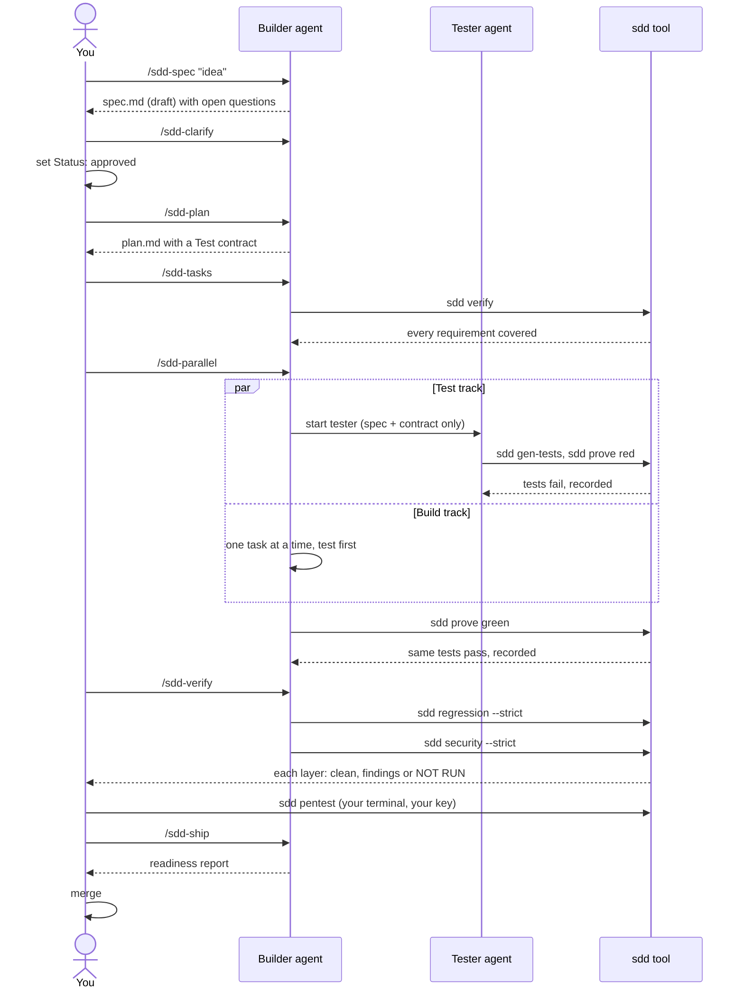
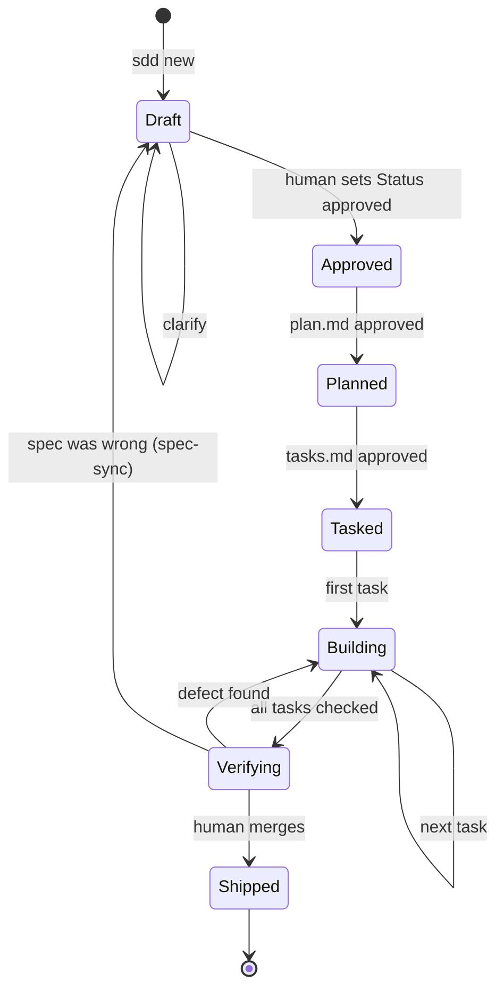

# Step-by-Step Workflow

Each phase has the same rhythm: **you ask → the agent produces one artifact and stops → you check → you approve.**

## Where a feature can be

Run `sdd next` at any time: it names the state of each feature and the single next action.

---

## The eleven steps

Steps 1 to 3 happen once. Steps 4 to 11 repeat for every feature. The same numbers and names are used in the README and in [Getting Started](Getting-Started).

| Step | Name | When | You | Result |
|---|---|---|---|---|
| 1 | Install the skill | Once per machine | Run one command | The skill is available to your agent |
| 2 | Set up the repository | Once per repository | Answer a few questions | Profile, config and the tool in `.sdd/` |
| 3 | Agree team rules | Once per repository | Ratify | `.sdd/constitution.md` |
| 4 | Write the spec | Every feature | Describe the idea | `spec.md` (draft) |
| 5 | Clarify and approve | Every feature | **Approve** | `spec.md` (approved) |
| 6 | Plan | Every feature | **Approve** | `plan.md` with a Test contract |
| 7 | Tasks | Every feature | **Approve** | `tasks.md` |
| 8 | Build and test in parallel | Every feature | Review each task | Code, acceptance tests, red → green proof |
| 9 | Verify | Every feature | Decide on findings | `verification.md` |
| 10 | Security gate | Every feature | Run the pentest, triage | Gate result per layer |
| 11 | Ship | Every feature | **Merge** | Released feature |

A step that belongs to a check your team switched off is skipped, and every report says so: see [Lifecycle Options](Lifecycle-Options).

## Step 1 · Install the skill *(once per machine)*

| | |
|---|---|
| **You run** | `npx skills add ashishmohanty-99/spec-driven-development` |
| **Result** | Your agent can use the skill in any repository |
| **More** | Other install routes are listed in [Getting Started](Getting-Started) |

## Step 2 · Set up the repository *(once per repository)*

| | |
|---|---|
| **You say** | "Set up spec-driven development in this repository" (or `/sdd-setup`) |
| **Tool does** | `sdd init --vendor`: reads file names and manifests (never secret files), detects the stack, installs the phase skills, copies itself to `.sdd/bin/`, hardens `.gitignore` |
| **Agent does** | Explains what it detected, then asks only the open questions, one at a time: test command, form of acceptance tests, where the app runs, which checks to keep |
| **Empty repository** | `/sdd-scaffold` proposes a folder structure for your stack and builds it after you approve: [Project Structure](Project-Structure) |
| **Optional** | `/sdd-init` has the agent run your build and test commands and record conventions and hazards in the profile |
| **Produces** | `.sdd/codebase-profile.md`, `.sdd/config.json` |
| **You check** | Commands are right. Protected paths list is complete |

## Step 3 · Agree team rules *(once, then amend)*

| | |
|---|---|
| **You type** | `/sdd-constitution` |
| **Agent does** | Drafts under 40 checkable rules from what CI and the repository already enforce |
| **Produces** | `.sdd/constitution.md` |
| **You do** | Edit, then set `Status: ratified` yourself |

## Step 4 · Write the spec

| | |
|---|---|
| **You type** | `/sdd-spec "Lock an account for 15 minutes after 5 failed logins"` |
| **Agent does** | Searches the codebase; writes requirements with permanent ids, non-goals, abuse cases for anything security-relevant, and a Given/When/Then scenario per requirement; marks every unknown `[NEEDS CLARIFICATION: …]` |
| **Produces** | `.sdd/specs/login-lockout/spec.md` (draft) |
| **You check** | Could two engineers write different tests for one requirement? Then it is too vague. Are non-goals listed? |

## Step 5 · Clarify and approve

| | |
|---|---|
| **You type** | `/sdd-clarify login-lockout` |
| **Agent does** | Answers what the code can answer; asks you at most five ranked questions, each with options and a recommendation |
| **You do** | Answer, then set `Status: approved` in `spec.md`. The agent may not |
| **Tool checks** | `sdd verify login-lockout` shows no errors |

## Step 6 · Plan

| | |
|---|---|
| **You type** | `/sdd-plan login-lockout` |
| **Agent does** | Read-only exploration; writes the approach, the rejected alternative, exact files, a requirement-to-design map, risks and rollback, and the **Test contract** (routes, labels and ids tests may rely on) |
| **You do** | Approve. Look hard at new dependencies, schema migrations and public API changes |
| **Produces** | `plan.md` |

## Step 7 · Tasks

| | |
|---|---|
| **You type** | `/sdd-tasks login-lockout` |
| **Agent does** | Small slices, at most about five files each: `- [ ] T-001 Count failed attempts (covers: REQ-001)` |
| **Tool checks** | Every requirement covered, no unlinked task |
| **You do** | Approve the list |

## Step 8 · Build and test in parallel

| | |
|---|---|
| **You type** | `/sdd-parallel login-lockout` |
| **Test track** | A separate tester agent, which never reads the implementation, runs `sdd gen-tests login-lockout`, then `sdd prove red login-lockout`. The tests must fail, and that is recorded |
| **Build track** | One task at a time: failing unit test that names the requirement, least code to pass, project checks, one commit, tick the task |
| **Join** | `sdd prove green login-lockout`: the same, unchanged test file must now pass |
| **You check** | Each task's diff stays in scope. The builder did not touch the acceptance tests |
| **One track at a time instead** | `/sdd-build login-lockout` per task and `/sdd-gen-tests login-lockout` for the tests |
| **More** | [Parallel Delivery](Parallel-Delivery), [Test Automation](Test-Automation) |

## Step 9 · Verify

| | |
|---|---|
| **You type** | `/sdd-verify login-lockout` |
| **Tool runs** | `sdd regression --strict`: your tests, the acceptance tests, every gate, the security gate |
| **Agent does** | Evidence table per requirement; independent review by the `spec-reviewer` subagent |
| **You do** | Decide on each finding |
| **Produces** | `verification.md` |

## Step 10 · Security gate

| | |
|---|---|
| **Tool runs** | `sdd security --strict`: secrets across the repository and its history, code scan, dependency audit; each reported as clean, findings, error or NOT RUN |
| **You run** | The penetration test, in your own terminal: `sdd pentest --target . --authorized` |
| **Agent does** | Plans scope, triages findings, records dispositions. It never sees your key |
| **More** | [Security Scanning](Security-Scanning), [Penetration Testing](Penetration-Testing) |

## Step 11 · Ship

| | |
|---|---|
| **You type** | `/sdd-ship login-lockout` |
| **Agent does** | Evidence, rollout and rollback plan, the list of checks your team switched off, pull request text |
| **You do** | Merge and deploy. The agent does not |

---

## When to skip all of this

One-line fixes, typos, and bugs with an obvious cause: fix, add a regression test, move on. If a "small" change grows past half an hour or several modules, write a three-requirement spec.

## When code and spec disagree

`/sdd-sync <feature>`. You decide which side is wrong. The agent never quietly edits a spec to match the code.
