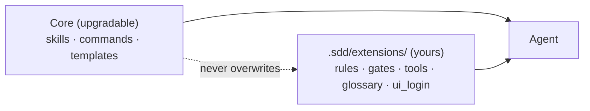

# Extending

Organisation-specific behaviour goes in `.sdd/extensions/`. `sdd init --force` upgrades the core and never touches this folder, so nothing proprietary has to live in SpecPilot itself.



| File | Effect | Read during |
|---|---|---|
| `rules.md` | Extra rules (naming, compliance, tenancy, data residency) | Plan, Verify |
| `gates.md` | Extra gates, e.g. "change ticket linked", "security sign-off" | Verify, Ship |
| `tools.md` | How to call internal tools: command, expected output, what failure means | Build, Verify, Ship |
| `glossary.md` | Domain vocabulary | Specify, Clarify |
| `ui_login.py` | Login flow for generated e2e tests | Test automation |
| `.sdd/templates/*.md` | Replace the spec / plan / tasks / ADR templates | `sdd new` |

## Example: wrap an internal tool without exposing it

`.sdd/extensions/tools.md`

```markdown
## Ticket link
- Run: `corp-tickets link --spec .sdd/specs/<feature>/spec.md`
- Expect: exit 0 and a ticket key. Put it in the spec header as `Ticket: KEY-123`.
- On failure: stop and ask the human. Never invent a key.
```

The agent learns how to *call* the tool. The tool's code and credentials stay where they are.

## Example gate

`.sdd/extensions/gates.md`

```markdown
- SHIP requires a `Ticket:` header in spec.md and a pentest record newer than the last auth change.
```

## Adding a skill

1. `specpilot/assets/skills/<name>/SKILL.md` with frontmatter `name` (equal to the folder) and a `description` that includes "Use when …".
2. Sections: Overview, process, Common Rationalizations, Red Flags, Verification.
3. Add a route in `using-sdd` and optionally a `commands/sdd-<name>.md`.
4. `python -m unittest` (the asset lint test checks the contract).

## Keep extensions clean

Extension files are committed and read by an AI agent. Refer to internal systems by name; do not put hostnames you consider sensitive, tokens, customer data or proprietary code in them. `sdd audit` scans this folder for credentials.
