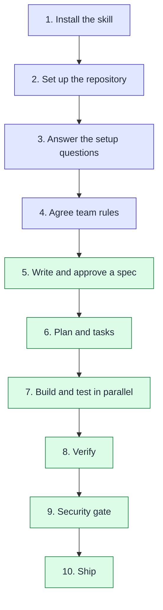
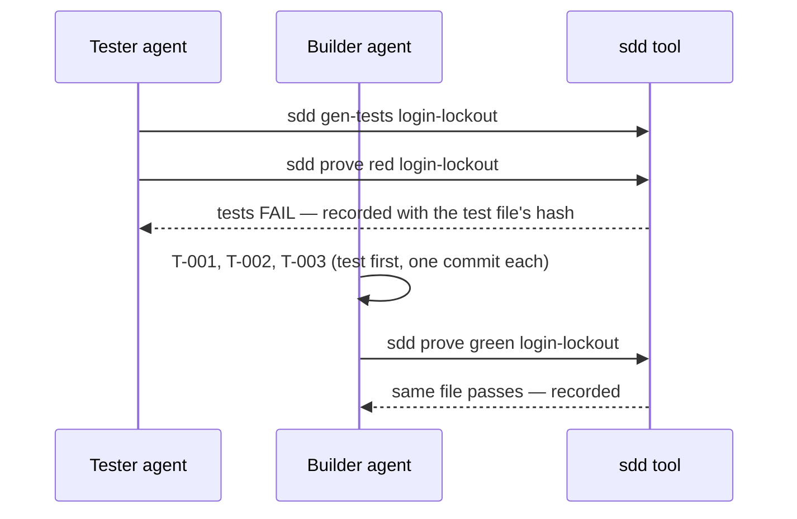

# Getting Started

A complete worked example: from installing the skill to shipping one feature. Allow about fifteen minutes for setup and your first spec. You need Python 3.11+ and an AI coding agent (Claude Code, Cursor, Codex, Copilot, Gemini CLI).

Throughout, commands that start with `/` are typed to your agent, and commands that start with `sdd` run in a terminal. After setup the tool lives in your project, so `sdd` means `python3 .sdd/bin/sdd.py` unless you installed the Python package.



Blue steps happen once per repository. Green steps repeat for every feature.

---

## Part 1: once per repository

### 1. Install the skill

```bash
npx skills add ashishmohanty-99/spec-driven-development
```

| Other route | How |
|---|---|
| Claude Code plugin | `/plugin install spec-driven-development-by-ashish-mohanty --marketplace ashishmohanty-99/spec-driven-development` |
| claude.ai | Clone the repository, run `python tools/build_skill.py`, upload `dist/sdd-skill.zip` at Customize → Skills |
| Python package | `pipx install git+https://github.com/ashishmohanty-99/spec-driven-development` |

### 2. Set up the repository

Open your project and tell the agent:

> Set up spec-driven development in this repository.

It runs `sdd init --vendor`. You will see something like:

```text
What I found:
  Languages:   TypeScript, Python
  Frameworks:  react, FastAPI
  Test tools:  vitest, pytest
  CI:          GitHub Actions
  Acceptance tests will be generated as: playwright-ts

What I did:
  + profiled codebase (412 files, TypeScript/Python)
  + installed skills -> .claude/skills
  + prepared tests/e2e/ for acceptance tests (playwright-ts)
  + vendored the CLI -> .sdd/bin
  + hardened .gitignore (.env, keys, scan output)
```

Only file names and manifests are read. `.env` files, keys and credential files are listed as protected and never opened.

### 3. Answer the setup questions

The agent asks only what it could not work out, one question at a time, with a recommended answer. "Use the defaults" is a valid reply.

| Question | Example answer |
|---|---|
| What are you building? *(empty repository only)* | "A React web app with a FastAPI backend" |
| What command runs your tests? | `pytest` |
| Which form should acceptance tests take? | `playwright-ts`, `playwright-python` or `gherkin` |
| Where does the app run locally? | `http://localhost:3000` |
| Keep the full lifecycle, or switch a check off? | "Keep everything" |

In an empty repository the agent then proposes a folder structure for your stack and waits for your approval before creating anything. See [Project Structure](Project-Structure).

Check the result:

```bash
sdd doctor
```

```bash
sdd audit
```

### 4. Agree team rules

```text
/sdd-constitution
```

The agent drafts a short list of rules from what your repository and CI already enforce. Edit it, then change `Status: draft` to `Status: ratified` **yourself**. Commit everything `init` created and open a pull request so the team sees it.

---

## Part 2: for every feature

The example feature: *lock an account for 15 minutes after 5 failed logins.*

### 5. Write and approve the spec

```text
/sdd-spec "Lock an account for 15 minutes after 5 failed logins"
```

The agent searches your code and writes `.sdd/specs/login-lockout/spec.md`:

```markdown
Status: draft

## 4. Requirements
- REQ-001: When a user fails login 5 times within 10 minutes, the auth service shall lock the account for 15 minutes.
- REQ-002: While an account is locked, the auth service shall reject valid credentials.

## 5a. Security requirements (abuse cases)
- REQ-S01: If a login fails, then the service shall not reveal whether the email exists.

## 6. Acceptance scenarios
- REQ-001 — Given the user opens /login, when they fill "wrong" into "Password" and they click "Sign in", then the page shows "Invalid email or password"
```

Anything it could not confirm is marked `[NEEDS CLARIFICATION: …]`. Resolve those:

```text
/sdd-clarify login-lockout
```

When you are satisfied, change `Status: draft` to `Status: approved`. The agent is not allowed to. Then:

```bash
sdd verify login-lockout
```

### 6. Plan and tasks

```text
/sdd-plan login-lockout
```

The plan names the exact files to change, maps each requirement to where it is satisfied, and includes a **Test contract**: the routes, labels and ids that tests may rely on. Approve it, then:

```text
/sdd-tasks login-lockout
```

```markdown
- [ ] T-001 Count failed attempts per account (covers: REQ-001)
- [ ] T-002 Reject logins while locked (covers: REQ-002)
- [ ] T-003 Uniform failure message (covers: REQ-S01)
```

Approve the list.

### 7. Build and test in parallel

```text
/sdd-parallel login-lockout
```



The tester never reads the implementation, so its tests check what was asked. The builder may not edit those tests. If the test file changes between red and green, the tool refuses the green run. More: [Parallel Delivery](Parallel-Delivery).

Prefer one step at a time? Use `/sdd-build login-lockout` for each task and `/sdd-gen-tests login-lockout` for the tests.

### 8. Verify

```text
/sdd-verify login-lockout
```

Underneath, this runs:

```bash
sdd regression --strict
```

```text
Regression summary:
  ok   pytest
  ok   npx playwright test tests/e2e
  ok   sdd verify (1 feature(s))
  ok   security: secrets  (clean: built-in engine, 0 finding(s))
  FAIL security: code-scan  (NOT RUN: no tool installed …)
```

That last line is the tool being honest: no analyser is installed, so it will not call the code clean. Install one for your stack, or switch that layer off with a reason. See [Security Scanning](Security-Scanning).

### 9. Security gate

```bash
sdd security --strict
```

| Layer | Runs | You need |
|---|---|---|
| Secrets (repository + history) | Always | Nothing. TruffleHog or gitleaks is used automatically if installed |
| Code scan | If an analyser is installed | semgrep, bandit, gosec or brakeman |
| Dependencies | If an auditor is installed | osv-scanner, trivy, pip-audit, npm audit … |
| Pentest | When you run it | Strix: see [Penetration Testing](Penetration-Testing) |

For a change that touches sign-in like this one, you also run the penetration test yourself:

```bash
sdd pentest --target . --authorized
```

### 10. Ship

```text
/sdd-ship login-lockout
```

You get the evidence per requirement, the rollout and rollback plan, and a list of any checks your team switched off. You merge and deploy.

---

## Whenever you are unsure

```bash
sdd next
```

```text
Features:
  login-lockout  [BUILD]
     -> Build task 2 of 3: /sdd-build login-lockout
     || in parallel (test track): record the failing run now: sdd prove red login-lockout
```

## Put it in CI

```yaml
permissions:
  contents: read
steps:
  - uses: actions/checkout@v4
    with:
      fetch-depth: 0
  - uses: actions/setup-python@v5
    with:
      python-version: "3.13"
  - run: python3 .sdd/bin/sdd.py verify --strict
  - run: python3 .sdd/bin/sdd.py security --strict
```

`fetch-depth: 0` gives the secret scan the full history.

## What to read next

| If you want to | Read |
|---|---|
| See every phase in detail | [Step-by-Step Workflow](Step-by-Step-Workflow) |
| Decide which checks to keep | [Lifecycle Options](Lifecycle-Options) |
| Understand the security layers | [Security Scanning](Security-Scanning) |
| Fix a message you do not understand | [Troubleshooting](Troubleshooting) |
