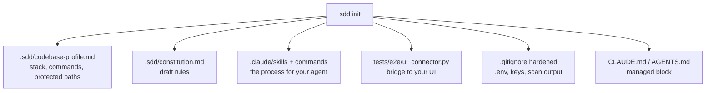

# Getting Started

Time: about 10 minutes. You need Python 3.11+ and an AI coding agent (Claude Code, Codex, Cursor, Copilot, Gemini CLI).

## 1. Install

```bash
pipx install git+https://github.com/ashishmohanty-99/spec-driven-development
```

No pipx? `pip install git+https://github.com/ashishmohanty-99/spec-driven-development` inside a virtual environment works too. The CLI has no third-party dependencies.

## 2. Initialise your repository

```bash
cd your-project
sdd init                 # Claude Code
sdd init --agent generic # any other agent (writes AGENTS.md and .agents/skills)
```



`init` never overwrites your files unless you pass `--force`, and it only reads file names and manifests. It does not open `.env` or key files.

## 3. Confirm the setup

```bash
sdd doctor   # is everything installed?
sdd audit    # any secrets or risky config?
```

## 4. Teach it your codebase (once)

In your agent:

| You type | The agent does | You check |
|---|---|---|
| `/sdd-init` | Runs the detected commands, reads sample modules, records conventions and hazards in the profile | Commands and conventions are right |
| `/sdd-constitution` | Drafts rules from what your repo already enforces | Edit, then set `Status: ratified` yourself |

## 5. Ship your first feature

```text
/sdd-spec "Lock an account for 15 minutes after 5 failed logins"
/sdd-clarify login-lockout      → you set Status: approved in spec.md
/sdd-plan login-lockout         → you approve
/sdd-tasks login-lockout        → you approve
/sdd-build login-lockout        → repeat per task
/sdd-gen-tests login-lockout
/sdd-verify login-lockout
/sdd-ship login-lockout         → you merge
```

Each command stops at a gate and waits for you. The full walkthrough, with what to look for at each gate, is in [Step-by-Step Workflow](Step-by-Step-Workflow).

## 6. Add it to CI

```yaml
permissions:
  contents: read
steps:
  - uses: actions/checkout@v4
  - run: pip install git+https://github.com/ashishmohanty-99/spec-driven-development
  - run: sdd audit
  - run: sdd regression --strict
```

> **Next:** [Step-by-Step Workflow](Step-by-Step-Workflow)
