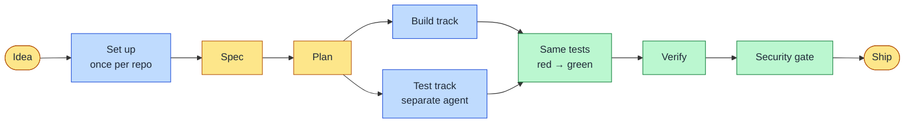

# Spec Driven Development By Ashish Mohanty

**Spec-Driven Development for the AI software lifecycle, in any language.** Install it in any repository. It learns the codebase, asks only what it cannot detect, then keeps your AI agent inside a gated process: nothing is built without an approved spec, every requirement is traced to a task and a test, and security is checked before ship.

Yellow needs a person's approval, blue is agent work, green is checked by the `sdd` tool. The complete walkthrough with a worked example is in [Getting Started](Getting-Started).

## Pick your path

| I want to… | Go to |
|---|---|
| Install and run my first feature in 10 minutes | [Getting Started](Getting-Started) |
| Start a brand-new application with a proper structure | [Project Structure](Project-Structure) |
| Decide which checks my team wants | [Lifecycle Options](Lifecycle-Options) |
| Understand why this process exists | [SDD and the AI SDLC](SDD-and-the-AI-SDLC) |
| See every phase, who acts, and what to check | [Step-by-Step Workflow](Step-by-Step-Workflow) |
| Generate acceptance tests from my spec, in my language | [Test Automation](Test-Automation) |
| Build and test in parallel, with proof the tests are honest | [Parallel Delivery](Parallel-Delivery) |
| Scan for secrets, vulnerable code and vulnerable packages | [Security Scanning](Security-Scanning) |
| Run a pentest without exposing my API key | [Penetration Testing](Penetration-Testing) |
| Know exactly what the tool can and cannot touch | [Security Model](Security-Model) |
| Look up a command | [CLI Reference](CLI-Reference) |

## What you get

| Piece | What it does |
|---|---|
| `sdd` CLI (Python, standard library only) | Profiles the repo, enforces gates, generates tests, guards the pentest |
| 17 skills | Teach the agent each phase, guided setup, project scaffolding, parallel delivery and the security gate, including the excuses it must not accept |
| 21 slash commands | `/sdd-setup`, `/sdd-spec`, `/sdd-plan`, `/sdd-build`, `/sdd-parallel`, `/sdd-security`, `/sdd-next` and the rest |
| 3 subagents (a spec reviewer, a codebase mapper and an independent tester) | Independent review of a diff against its spec; read-only codebase mapping |
| Templates | Constitution, spec (EARS requirements), plan, tasks, ADR |

## The four rules

1. **No spec, no code.** A human approves the spec, the plan and the task list. The agent never approves its own work.
2. **Everything is traceable.** `REQ-001` → `T-001` → a test that names `REQ-001`. `sdd verify` fails when a requirement has no task or a task has no requirement; with `--strict` (use it in CI) it also fails when a finished requirement has no real test.
3. **You choose the checks.** Everything is on by default. Any optional check can be switched off, with its cost stated and your reason recorded. Lost? `sdd next`.
4. **Secrets stay out.** No key in chat, specs, config or commits. `sdd audit` checks, and the pentest step reads its model settings from your environment only.
