# SpecPilot

**Spec-Driven Development for the AI software lifecycle.** Install it in any repository. It learns the codebase, then keeps your AI agent inside a gated process: nothing is built without an approved spec, every requirement is traced to a task and a test, and security is checked before ship.

```mermaid
flowchart LR
    A([Idea]) --> B[Discover]
    B --> C[Constitute]
    C --> D[Specify]
    D --> E[Clarify]
    E --> F[Plan]
    F --> G[Tasks]
    G --> H[Build]
    H --> I[Test automation]
    I --> J[Verify]
    J --> K[Security]
    K --> L([Ship])

    classDef human fill:#fde68a,stroke:#b45309,color:#1f2937
    classDef agent fill:#bfdbfe,stroke:#1d4ed8,color:#1f2937
    classDef tool fill:#bbf7d0,stroke:#15803d,color:#1f2937
    class A,L human
    class B,C,D,E,F,G,H agent
    class I,J,K tool
```

Yellow is a human decision, blue is agent work that stops at a human gate, green is checked by the `sdd` CLI.

## Pick your path

| I want to… | Go to |
|---|---|
| Install and run my first feature in 10 minutes | [Getting Started](Getting-Started) |
| Understand why this process exists | [SDD and the AI SDLC](SDD-and-the-AI-SDLC) |
| See every phase, who acts, and what to check | [Step-by-Step Workflow](Step-by-Step-Workflow) |
| Generate browser tests from my spec | [Test Automation](Test-Automation) |
| Run a pentest without exposing my API key | [Penetration Testing](Penetration-Testing) |
| Know exactly what the tool can and cannot touch | [Security Model](Security-Model) |
| Look up a command | [CLI Reference](CLI-Reference) |

## What you get

| Piece | What it does |
|---|---|
| `sdd` CLI (Python, standard library only) | Profiles the repo, enforces gates, generates tests, guards the pentest |
| 13 skills | Teach the agent each phase, including the excuses it must not accept |
| 15 slash commands | `/sdd-spec`, `/sdd-plan`, `/sdd-build` and the rest |
| 2 reviewer subagents | Independent review of a diff against its spec; read-only codebase mapping |
| Templates | Constitution, spec (EARS requirements), plan, tasks, ADR |

## The three rules

1. **No spec, no code.** A human approves the spec, the plan and the task list. The agent never approves its own work.
2. **Everything is traceable.** `REQ-001` → `T-001` → a test that names `REQ-001`. `sdd verify` fails the build when a link is missing.
3. **Secrets stay out.** No key in chat, specs, config or commits. `sdd audit` checks, and the pentest step reads its model settings from your environment only.
