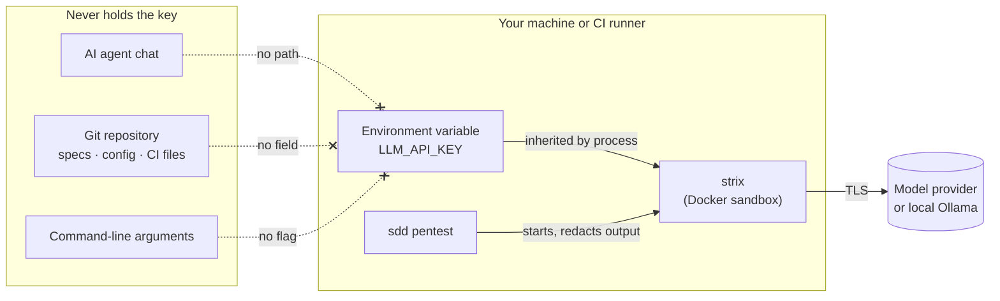
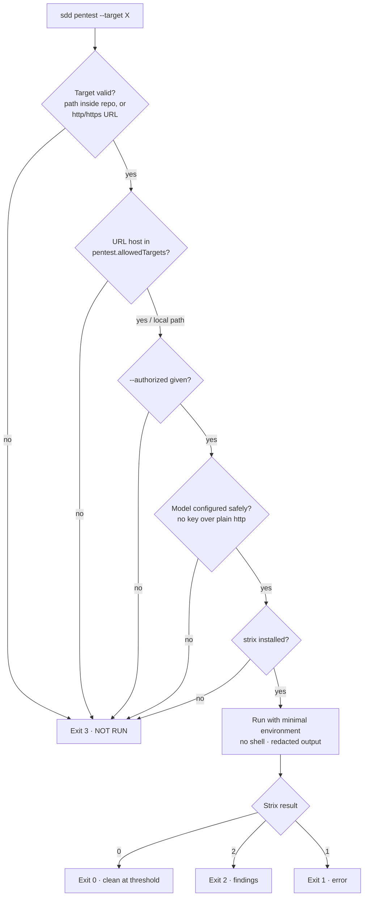

# Penetration Testing

`sdd pentest` is a guarded wrapper around [Strix](https://github.com/usestrix/strix), an open-source AI pentesting agent. SpecPilot does not contain Strix; it decides whether a scan may start, and how.

## Your API key never leaves your machine



- There is **no** `--api-key` flag, config field, or prompt. The only place a key can live is an environment variable that you set.
- The agent plans the scan and triages results. **You** run the command, so the agent never needs the key.
- Output is passed through a redactor that removes the key value and common token shapes.

## Option A (recommended): no key at all

Run a local model. Nothing can leak because nothing exists.

```bash
pipx install strix-agent
ollama pull qwen3-vl
export STRIX_LLM=ollama/qwen3-vl
export LLM_API_BASE=http://localhost:11434
sdd pentest --target . --authorized
```

## Option B: hosted model, key in your shell only

```bash
read -rs LLM_API_KEY && export LLM_API_KEY   # typed invisibly, not saved to shell history
export STRIX_LLM=openai/gpt-5                # any provider Strix supports
sdd pentest --target . --authorized --max-budget 5
unset LLM_API_KEY
```

Use a key created only for scanning, with a spending limit, and rotate it.

## Option C: CI, key in the secret store

```yaml
name: pentest
on: workflow_dispatch          # manual only; never pull_request_target
permissions:
  contents: read
jobs:
  scan:
    runs-on: ubuntu-latest
    environment: security       # add required reviewers to this environment
    steps:
      - uses: actions/checkout@v4
      - run: pipx install strix-agent
      - run: pip install git+https://github.com/ashishmohanty-99/spec-driven-development
      - run: sdd pentest --target . --authorized --fail-on high
        env:
          STRIX_LLM: ${{ vars.STRIX_LLM }}
          LLM_API_KEY: ${{ secrets.LLM_API_KEY }}
```

## What the guard checks before anything starts



| Exit code | Meaning | Is it a pass? |
|---|---|---|
| 0 | Scan ran, nothing at or above `--fail-on` | Yes |
| 2 | Scan ran, findings | No: triage |
| 1 | Scan failed to complete | No |
| **3** | **Scan did not run** | **No. Unknown is not clean** |

## Scanning a deployed environment

A human who is authorised to test that system adds its hostname to `.sdd/config.json`:

```json
{ "pentest": { "allowedTargets": ["staging.example.com"], "failOn": "high" } }
```

```bash
sdd pentest --target https://staging.example.com --authorized
```

The agent is instructed never to edit this list. Scanning systems you do not own is illegal in most places.

## After the scan

1. Reports are in `strix_runs/` (git-ignored: they describe how to attack your app).
2. A small record without secrets is written to `.sdd/security/pentest-<time>.json`.
3. In your agent: `/sdd-pentest` to triage. Each finding is fixed (new `REQ-` + regression test), risk-accepted by a named person, or shown to be a false positive.
4. The disposition goes into `verification.md`. `/sdd-ship` requires it for security-relevant changes.

## Cheaper checks to run every time

```bash
sdd audit        # committed secrets, tracked .env, risky CI config
pip-audit        # known-vulnerable dependencies
bandit -r src    # static analysis
```
