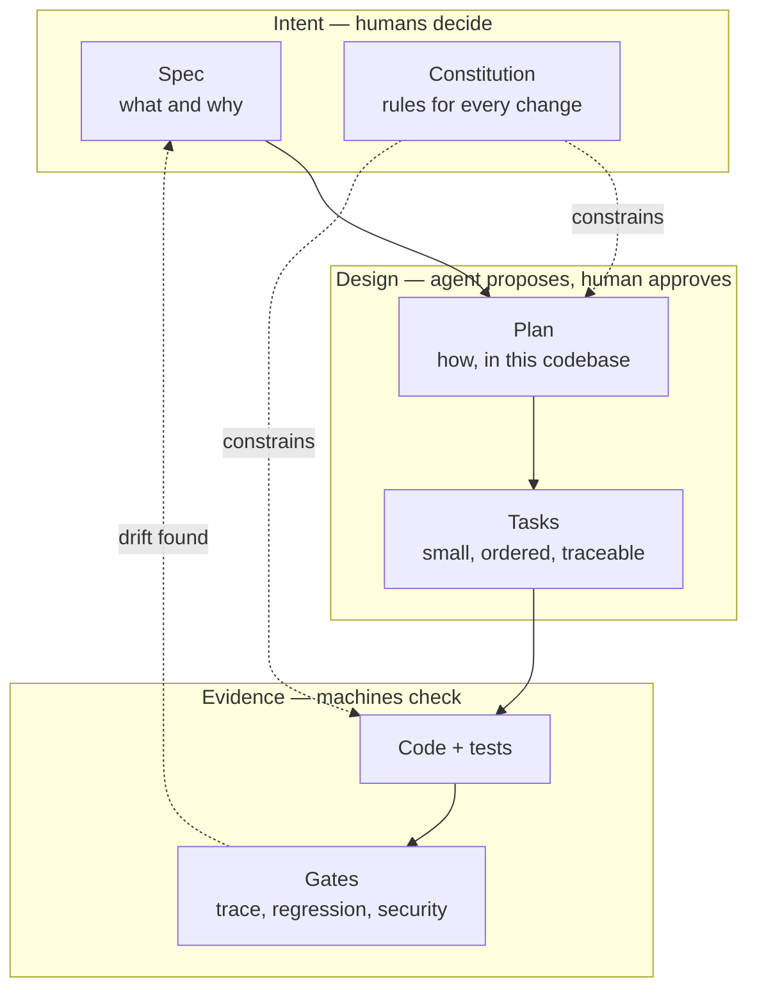
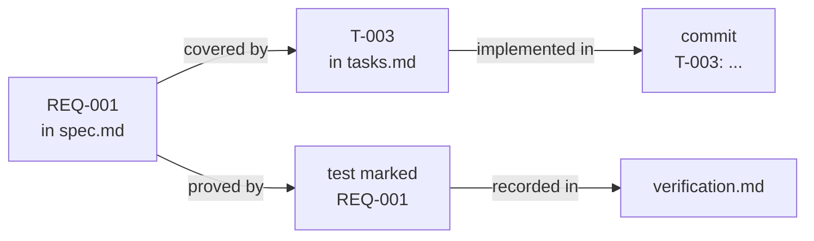

# SDD and the AI SDLC

## The problem

An AI agent writes code faster than a team can review it. Two things go wrong:

- **It guesses.** A chat message is not a requirement. The agent fills the gaps with plausible assumptions and builds the wrong thing confidently.
- **It does not know your codebase.** It puts code in the wrong layer, adds a dependency you would have refused, or "fixes" a test to make it pass.

Review after the fact does not scale to that speed. The control has to move earlier.

## The idea

**Spec-Driven Development (SDD)** makes the specification the source of truth, written and approved before code. The human controls *what* and *whether*; the agent does the *how*, inside limits.

## How SDD maps onto the AI SDLC

| Classic SDLC stage | With an AI agent, the risk is… | SpecPilot phase | Artifact | Who decides |
|---|---|---|---|---|
| Requirements | Guessed intent | Specify, Clarify | `spec.md` with `REQ-` ids | Human approves |
| Analysis | Ignorance of the codebase | Discover, Constitute | Profile, constitution | Human confirms |
| Design | Unreviewed architecture | Plan | `plan.md`, ADRs | Human approves |
| Implementation | Huge unreviewable diffs | Tasks, Build | `tasks.md`, small commits | Human approves list |
| Testing | Tests written to pass | Test automation, Verify | Generated e2e tests, `verification.md` | CLI gates |
| Security | Nobody looked | Security | Pentest record, `sdd audit` | Human triages |
| Release | No rollback plan | Ship | Definition of done | Human merges |
| Maintenance | Spec and code drift apart | Spec-sync | Decision log | Human decides direction |

## Traceability: the mechanism that makes it enforceable

`sdd verify` reads these files and fails when a requirement has no task, a task has no requirement, or a finished requirement has no test that names it. The agent cannot argue with an exit code.

## Requirements people can test: EARS

Each requirement is one sentence in a fixed shape, so it can be proved true or false.

| Pattern | Shape | Example |
|---|---|---|
| Event | When *trigger*, the *system* shall *response* | When a user fails login 5 times in 10 minutes, the auth service shall lock the account for 15 minutes. |
| State | While *state*, the *system* shall *response* | While an account is locked, the auth service shall reject valid credentials. |
| Unwanted | If *condition*, then the *system* shall *response* | If the lock store is unavailable, then the auth service shall deny login. |
| Ubiquitous | The *system* shall *response* | The auth service shall log every lockout. |

## What is human, what is agent, what is machine

| | Human | Agent | `sdd` CLI |
|---|---|---|---|
| Decides scope and approves | ✅ | ❌ | ❌ |
| Drafts specs, plans, code | reviews | ✅ | ❌ |
| Checks order, coverage, secrets | ❌ | ❌ | ✅ |
| Merges and deploys | ✅ | ❌ | ❌ |

> **Next:** [Step-by-Step Workflow](Step-by-Step-Workflow)
