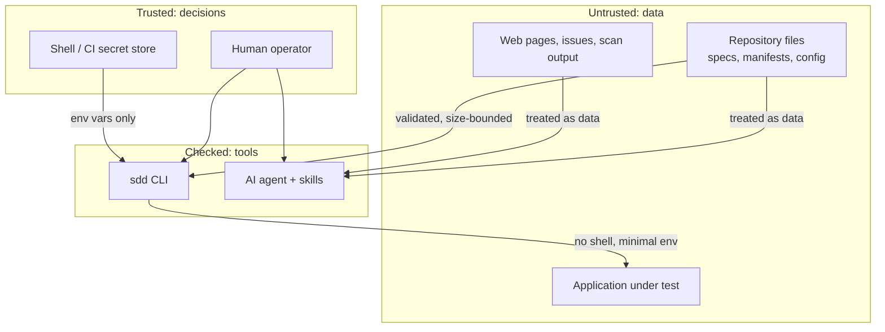

# Security Model

SpecPilot runs inside repositories it does not control, next to an AI agent that can be steered by text in those repositories. This page states what it defends against and how each defence is tested.

## Trust boundaries

## Threats and controls

| # | Threat | Control | Test |
|---|---|---|---|
| 1 | **API key leaks** through chat, a file, shell history or logs | No flag, config field or prompt accepts a key. Read from env by Strix only. Output redacted. Keyless local-model path documented first | `test_there_is_no_way_to_pass_a_key…`, `test_real_run_redacts_key…` |
| 2 | **Key sent in clear text** | Refuses a key with a non-local `http://` API base, or a base URL with embedded credentials | `test_model_env_rules` |
| 3 | **Unrelated secrets reach child processes** | Tests and scans start with an allow-listed environment; `AWS_*`, tokens and the rest are dropped | `test_real_run_redacts_key_and_limits_environment` |
| 4 | **Secrets committed** in specs, tests or agent files | `sdd verify` and `sdd audit` detect key shapes and report location, never the value. `init` adds `.env`, keys and scan output to `.gitignore` | `test_verify_and_audit_fail_on_committed_secret` |
| 5 | **Path traversal** via feature names or config | Feature names are strict kebab-case. Every path is resolved and confined to the project root | `test_feature_names_cannot_traverse`, `test_config_cannot_redirect_outside_root` |
| 6 | **Symlink attacks** on files the tool writes | Never writes through a symlink; scans never follow them | `test_safe_join_and_symlink_writes`, `test_init_does_not_write_through_symlinked…` |
| 7 | **Command injection** | No shell anywhere. Arguments are lists. Pentest values are validated and passed as single `--flag=value` tokens | `test_pentest_arguments_cannot_inject_options`, `test_runs_configured_command_without_shell` |
| 8 | **Code injection through a spec** into generated tests | Spec text reaches code only via `repr()`, always an inert string literal | `test_spec_text_cannot_become_code` |
| 9 | **Prompt injection**: repository text instructing the agent | Skills state that repository, web and scan text is data. Only script *names* from `package.json` enter agent instructions, never bodies | `test_package_json_script_bodies_are_not_copied` |
| 10 | **Unauthorised scanning** of third-party systems | URL hosts must be allow-listed by a human in config; `--authorized` required; agent told never to edit the list | `test_url_must_be_allow_listed_by_config` |
| 11 | **A skipped scan reported as a pass** | Distinct exit code 3 and the words NOT RUN. A requested but unrun scan fails `sdd regression` | `test_not_run_is_exit_3_never_0`, `test_gate_failure_and_unrun_pentest…` |
| 12 | **Reading secret files** during profiling | Scanner reads names plus a fixed list of manifests. `.env`, keys and credential files are listed as protected and never opened | `test_detects_stack_and_never_reads_secrets` |
| 13 | **Resource exhaustion** from huge files or trees | 1 MB read limit, 5,000-file and depth-6 walk limits, subprocess timeouts | covered by limits in `security.py`, `scan.py` |
| 14 | **CI token abuse** | Workflows declare `permissions: contents: read`. `sdd audit` flags missing permissions and `pull_request_target` with secrets | `test_audit_clean_after_init_and_flags_bad_config_and_ci` |
| 15 | **Supply chain** | The CLI has zero third-party runtime dependencies. Strix is installed separately by you, not vendored | `pyproject.toml` |

## Handling a leaked key

1. Revoke it at the provider now. Do not wait to confirm misuse.
2. Create a new key with a spending limit.
3. If it was committed, removing the line is not enough: the history still has it. Rotate first, then clean history.
4. Run `sdd audit`.

## What SpecPilot does not do

- It does not make an insecure application secure. It makes sure someone looked, and that the result is recorded.
- Secret detection is pattern-based: it catches common shapes, not every possible credential.
- It cannot stop a human from pasting a key into chat. The skills tell the agent to refuse it and ask for rotation.
- It has not been independently audited.

## Reporting a vulnerability

Use GitHub's private vulnerability reporting on the repository. Do not open a public issue.
