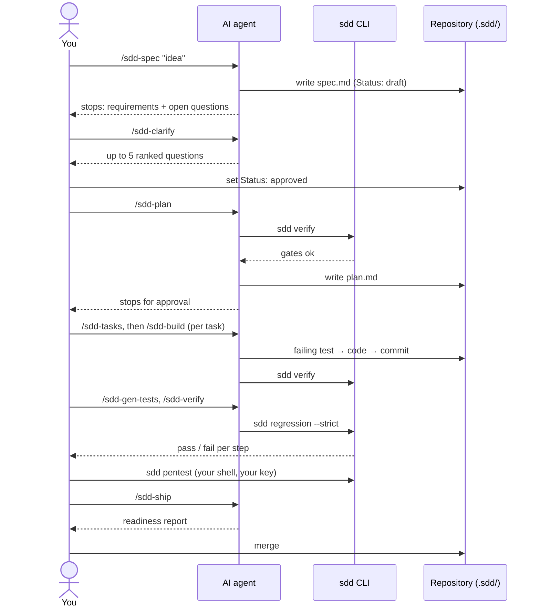
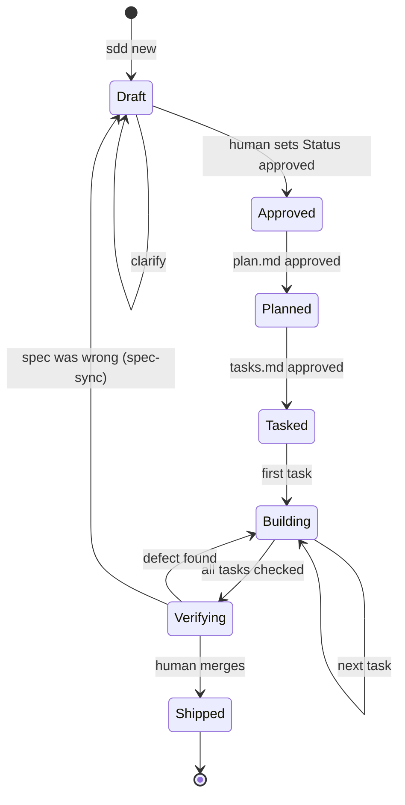

# Step-by-Step Workflow

Each phase has the same rhythm: **you ask → the agent produces one artifact and stops → you check → you approve.**

## Where a feature can be

Run `sdd status` at any time to see which state each feature is in.

---

## Phase 0 · Discover *(once per repository)*

| | |
|---|---|
| **You type** | `/sdd-init` |
| **Agent does** | Runs `sdd scan`, executes the detected build/test/lint commands, reads sample modules, records conventions, seams and hazards |
| **Produces** | `.sdd/codebase-profile.md` |
| **You check** | Commands are right. Conventions match reality. Protected paths list is complete |

## Phase 1 · Constitute *(once, then amend)*

| | |
|---|---|
| **You type** | `/sdd-constitution` |
| **Agent does** | Drafts under 40 checkable rules from what CI and the repo already enforce |
| **Produces** | `.sdd/constitution.md` |
| **You do** | Edit, then set `Status: ratified` |

## Phase 2 · Specify

| | |
|---|---|
| **You type** | `/sdd-spec "Lock an account for 15 minutes after 5 failed logins"` |
| **Agent does** | Searches the codebase, writes EARS requirements with permanent ids, non-goals, boundaries, and marks every unknown `[NEEDS CLARIFICATION: …]` |
| **Produces** | `.sdd/specs/login-lockout/spec.md` (draft) |
| **You check** | Could two engineers write different tests for one requirement? Then it is too vague. Are non-goals listed? |

## Phase 3 · Clarify

| | |
|---|---|
| **You type** | `/sdd-clarify login-lockout` |
| **Agent does** | Answers what the code can answer; asks you at most five ranked questions, each with options and a recommendation |
| **You do** | Answer, then set `Status: approved` in `spec.md` |
| **Gate** | `sdd verify login-lockout` shows no errors |

## Phase 4 · Plan

| | |
|---|---|
| **You type** | `/sdd-plan login-lockout` |
| **Agent does** | Read-only exploration; writes the approach, the rejected alternative, exact files, interfaces, a requirement-to-design map, risks and rollback |
| **You check** | "Ask first" items: new dependency, schema migration, public API change |

## Phase 5 · Tasks

| | |
|---|---|
| **You type** | `/sdd-tasks login-lockout` |
| **Agent does** | Vertical slices, at most ~5 files each: `- [ ] T-001 Count failed attempts (covers: REQ-001)` |
| **Gate** | Every requirement covered, no orphan task |

## Phase 6 · Build *(repeat per task)*

| | |
|---|---|
| **You type** | `/sdd-build login-lockout` |
| **Agent does** | Failing test that names the requirement → least code to pass → project checks → one commit → ticks the task |
| **You check** | The diff stays inside the task's files. The test asserts the requirement, not the implementation |

## Phase 7 · Test automation

| | |
|---|---|
| **You type** | `/sdd-gen-tests login-lockout` |
| **Tool does** | Turns each Given/When/Then scenario into a browser test marked with its requirement id |
| **More** | [Test Automation](Test-Automation) |

## Phase 8 · Verify

| | |
|---|---|
| **You type** | `/sdd-verify login-lockout` |
| **Agent does** | `sdd regression --strict`, `sdd audit`, evidence table per requirement, independent review by the `spec-reviewer` subagent |
| **Produces** | `verification.md` |

## Phase 9 · Security

| | |
|---|---|
| **You run** | `sdd pentest --target . --authorized` in your own shell |
| **Agent does** | Plans scope, triages findings, records dispositions. It never sees your key |
| **More** | [Penetration Testing](Penetration-Testing) |

## Phase 10 · Ship

| | |
|---|---|
| **You type** | `/sdd-ship login-lockout` |
| **Agent does** | Definition-of-done evidence, rollout and rollback plan, PR description |
| **You do** | Merge and deploy. The agent does not |

---

## When to skip all of this

One-line fixes, typos, and bugs with an obvious cause: fix, add a regression test, move on. If a "small" change grows past half an hour or several modules, write a three-requirement spec.

## When code and spec disagree

`/sdd-sync <feature>`. You decide which side is wrong. The agent never quietly edits a spec to match the code.
