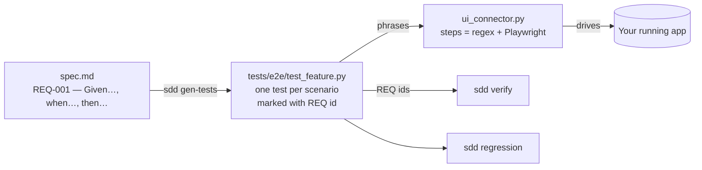
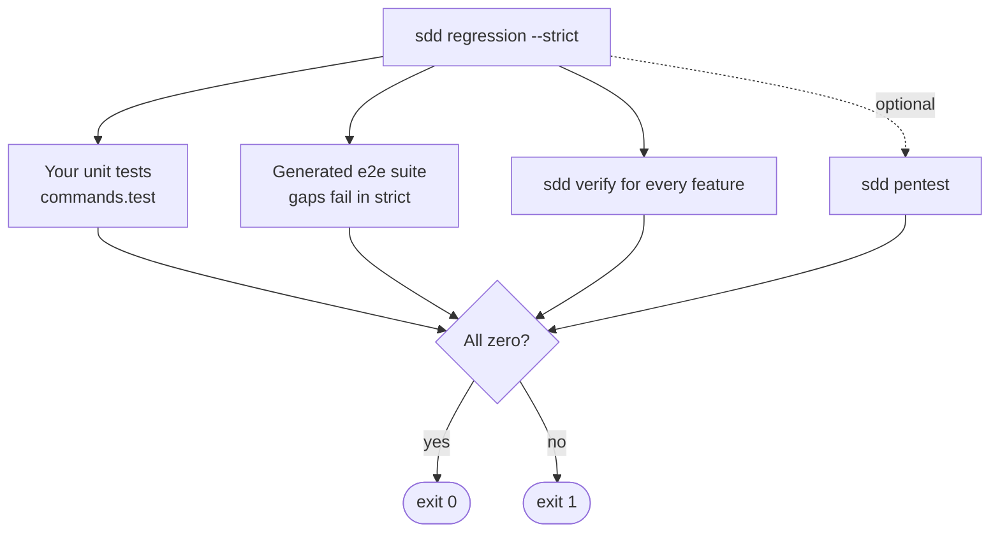

# Test Automation

The spec that defines "done" also generates the test that proves it.



## 1. Write scenarios in the spec

In section 6 of `spec.md`, one line per scenario. A dash after the id (a colon would define a new requirement):

```markdown
- REQ-001 — Given the user opens /login, when they fill "wrong" into "Password" and they click "Sign in", then the page shows "Invalid email or password"
```

## 2. Generate

```bash
sdd gen-tests login-lockout
```

You get `tests/e2e/test_login_lockout.py`:

```python
@pytest.mark.requirement('REQ-001')
def test_req_001_1(page):
    # REQ-001
    run_scenario(
        page,
        given='the user opens /login',
        when='they fill "wrong" into "Password" and they click "Sign in"',
        then='the page shows "Invalid email or password"',
    )
```

No selectors appear in the test. Requirements without a scenario become visible gaps: skipped locally, **failed** under `--strict`.

## 3. Built-in phrases (work with no code)

| Write this in a scenario | What runs |
|---|---|
| `the user opens /path` | Navigate to `SDD_BASE_URL` + path |
| `the user is logged in` / `logged in as admin` | Your `ui_login.py` |
| `they click "Save"` | Click the button or link with that name |
| `they fill "value" into "Label"` | Fill the labelled field |
| `the page shows "text"` | Assert the text is visible |
| `the page does not show "text"` | Assert it is absent |
| `the url contains /dashboard` | Assert the address |

Join actions with "and": `they fill "a" into "Email" and they click "Next"`.

## 4. Add your own steps

Anything else is one function at the bottom of `tests/e2e/ui_connector.py`:

```python
@step(r'the cart shows (?P<count>\d+) items?')
def cart_count(page, count):
    expect(page.get_by_test_id("cart-count")).to_have_text(count)
```

## 5. Logged-in scenarios

Copy `.sdd/extensions/ui_login.example.py` to `ui_login.py` and adapt the form fields. Credentials come from environment variables, from a dedicated low-privilege test account:

```bash
export SDD_UI_USER=qa@example.com
export SDD_UI_PASS=…          # from your secret manager, never typed into chat or a file
```

## 6. Run

```bash
pip install pytest-playwright
playwright install chromium
SDD_BASE_URL=http://localhost:3000 pytest tests/e2e
```

## 7. One command for everything

```bash
sdd regression --strict
```



## Regenerating

Run `sdd gen-tests` again after any spec change. Only the block between the `GENERATED` markers is rewritten. Tests you add below the end marker are kept.
